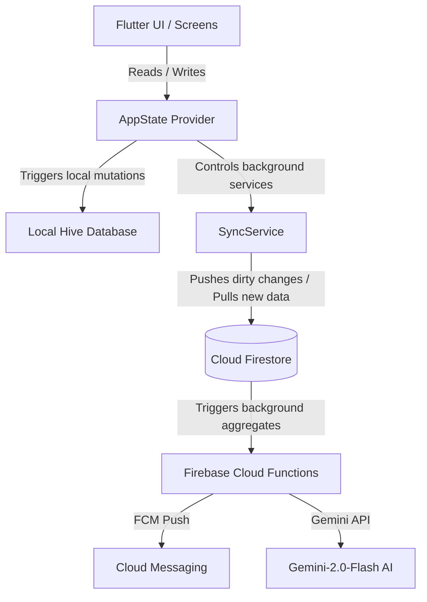

# AGENTS.md

Welcome, AI Agent! This document is designed to give you an immediate, high-fidelity technical understanding of the **NUmer** codebase so you can modify, debug, or extend the app safely and efficiently without violating established patterns.

---

## 🛠 System Architecture

NUmer is designed as an **offline-first** client-server architecture:

1. **Flutter Frontend**: Main application logic, UI, and navigation. Uses standard `Provider` and `ChangeNotifier` state management.
2. **Local Caching (Hive)**: The application stores *everything* locally first in Hive boxes. If there is no internet, the app works fully (except for study groups and AI recommendations).
3. **Synchronization (`SyncService`)**: Connects Hive and Cloud Firestore. Any updated or created local entity gets marked with a `dirty` flag and gets synchronized to Firestore once online.
4. **Backend (Cloud Functions)**: Written in TypeScript (located in [functions](file:///Users/anx/numer_app/functions)). Computes leaderboards, handles security-sensitive tasks (like join codes, account deletions), sends FCM pushes, and connects to Gemini.

---

## 📂 Key Code Locations

### Frontend (Flutter)

- **Global App State**: [lib/app_state.dart](file:///Users/anx/numer_app/lib/app_state.dart)
  - This is the central `ChangeNotifier` for the app. It holds active session states, settings, timers, alarms, and notifies listeners on updates.
- **Local Storage Interface**: [lib/services/storage.dart](file:///Users/anx/numer_app/lib/services/storage.dart)
  - Wraps Hive boxes. Use this for reading/writing local models.
- **Synchronization Engine**: [lib/services/sync_service.dart](file:///Users/anx/numer_app/lib/services/sync_service.dart)
  - Monitors connectivity (`connectivity_plus`) and performs full syncs, heartbeats, and local-remote resolution.
- **Connections Feature**:
  - Service: [lib/services/connections_service.dart](file:///Users/anx/numer_app/lib/services/connections_service.dart)
  - Model: [lib/models/person.dart](file:///Users/anx/numer_app/lib/models/person.dart)
  - Screens: [lib/screens/connections/](file:///Users/anx/numer_app/lib/screens/connections/)
- **Habits Feature**:
  - Service: [lib/services/habit_service.dart](file:///Users/anx/numer_app/lib/services/habit_service.dart)
  - Model: [lib/models/habit.dart](file:///Users/anx/numer_app/lib/models/habit.dart)
  - Screens: [lib/screens/habits/](file:///Users/anx/numer_app/lib/screens/habits/)
- **Study Groups**:
  - Service: [lib/services/group_service.dart](file:///Users/anx/numer_app/lib/services/group_service.dart)
  - Screens: [lib/screens/groups/](file:///Users/anx/numer_app/lib/screens/groups/)

### Backend (Firebase)

- **Cloud Functions Source**: [functions/src/index.ts](file:///Users/anx/numer_app/functions/src/index.ts)
  - Contains all Firestore triggers (calculating leaderboards) and HTTPS Callable Functions (nudges, join codes, AI analysis).
- **Firestore Security Rules**: [firestore.rules](file:///Users/anx/numer_app/firestore.rules)
  - Enforces database access controls. Make sure you read these rules if you add new collections or edit reading permissions.

---

## ⚡ Core Development Rules for Agents

### 1. Maintain the Offline-First Contract
**Never write directly to Firestore from UI screens.**
- Always mutate local Hive objects via [storage.dart](file:///Users/anx/numer_app/lib/services/storage.dart).
- Ensure models are written with `dirty = true` and `updatedAt = DateTime.now()`.
- Let `SyncService` propagate changes asynchronously. Writing directly to Firestore disrupts the synchronization sequence and will cause sync loops or overwrite conflicts.

### 2. State Hydration Checklist
If you modify `AppState`, ensure your changes:
- Are loaded during the `_performLoad` routine in `AppState.load()` (e.g. read from local Storage).
- Call `notifyListeners()` when mutated.
- Save their updated state persistently to Hive or `SharedPreferences`.

### 3. Modifying Data Models
When adding fields to models (e.g. `Course`, `Habit`, `Person`):
- Update their `toJson()` and `fromJson()` serialize methods.
- Ensure compatibilities with existing schemas. Hive database schema modifications might require incremental type adapter IDs or migration logic.

### 4. Firestore Security Rules Compliance
Before making changes that involve writing or reading collections:
- Check if your collections are protected. In `firestore.rules`, all data (like `habits`, `connections`, `courses`, `sessions`) is strictly owner-read-write, with the exception of `/groups`, `/users` profiles, and user aggregates/sessions (if in a shared study group).
- If you add a subcollection under `/users/{userId}/`, you **must** update `firestore.rules` to allow owner access.

### 5. Multi-lingual Support
NUmer is fully localized into English (`en`), Russian (`ru`), and Kazakh (`kk`).
- When writing UI components, retrieve strings from `AppLocalizations.of(context)`.
- Localization keys are declared in translation files.

---

## 📝 Common Gotchas & Troubleshooting

### Local Database Generation
If you receive build runner or type adapter errors in Dart:
- Verify that your Hive annotations (`@HiveType`, `@HiveField`) are set correctly.
- If you need to rebuild Hive adapters, ensure you run the appropriate code generator.

### Firebase Emulator
If you test Cloud Functions locally, set `useEmulator = true` or configure your Firebase Options to target localhost. The emulator Suite covers Auth, Firestore, and Functions.

### Gemini API Key Configuration
If the AI analysis fails:
- Check that the `GEMINI_API_KEY` is configured in your functions configuration.
- The Cloud Function `analyzeCourseAi` uses the `gemini-2.0-flash` model. If you modify the prompt or parameters, keep it light and optimized.
