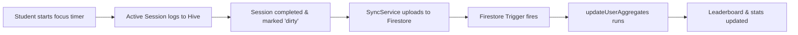

# NUmer

A collaborative study group and personal productivity app built with Flutter and Firebase. NUmer helps students manage courses, track habits, set alarms, log study sessions (with Pomodoro, Timer, and Stopwatch), sync data offline-first, organize group leaderboards, nudging peers, and receive AI-powered progress insights.

## What is this?

This project is built for students and study groups who want to boost their focus, track their learning habits, and study together seamlessly. Instead of using disconnected tools for time tracking, habits, calendars, and groups, NUmer integrates everything into a single, beautiful dashboard.

It is designed for students seeking structured study routines, study group leaders wishing to foster friendly competition via leaderboards, and students wanting localized notifications, exports, and AI-driven analysis of their academic progress.

## Features

- **Personalized Onboarding & Profile Setup**: Seamless onboarding flow with profile pictures (avatars), custom names, majors, and study goals.
- **Robust Course & Goal Management**: Create courses, set expected weekly study goals (hours), track credits, experience levels, and sort orders.
- **Multiple Focus Timers**:
  - **Pomodoro Timer**: Work and short/long break phases with customizable duration, auto-saving sessions, and break pings.
  - **Count-up Stopwatch**: Standard focus session recording.
  - **Count-down Timer**: Time-bound study focus.
- **Interactive Habit Tracker**:
  - Define custom habits with dynamic frequency rules (daily, weekly, specific days).
  - Swipe to complete daily tasks with high-fidelity micro-interactions.
  - Archive, category categorization, and heatmaps/calendars visualizing streaks.
- **Connections & Social Logging**:
  - Log interactions (touchpoints) with friends, classmates, or project members.
  - Set contact reminders (e.g. follow-up notifications if not contacted in 30 days).
  - Track birthdays and custom tags per connection.
- **Study Groups & Leaderboards**:
  - Create public or private study groups (with secure join codes).
  - Live leaderboards comparing study duration (today, 7 days, monthly).
  - Real-time aggregate statistics.
  - **"Nudge" Push Notifications**: Send motivating nudge pings (supporting EN/RU/KK translations) to peers directly using Firebase Cloud Messaging (FCM).
- **AI-Powered Insights**:
  - Integrated Gemini API via Google Cloud/Firebase Functions to analyze courses and study behaviors.
  - Personalized recommendations to optimize focus.
- **Offline-First Synchronization**:
  - Real-time caching with Hive.
  - Custom `SyncService` handling local-to-remote dirty queues and conflict resolution.
- **Data Exporting**:
  - Export study session logs to `.ics` (Calendar), `.csv`, or `.xlsx` (Excel) formats.
- **Alarm & Notification Engine**:
  - Local push notifications via `flutter_local_notifications`.
  - Background recording notifications while timers are active.

## Tech Stack

| Technology | Purpose |
|------------|---------|
| Flutter (Dart) | Main cross-platform mobile application framework |
| Provider | State management and dependency injection |
| Hive | Offline-first local database and persistence |
| Firebase Authentication | User sign-in and account management |
| Cloud Firestore | Real-time cloud database for multi-device synchronization |
| Cloud Functions | Serverless functions for group management, nudges, account deletions, and Gemini AI |
| Cloud Messaging (FCM)| Push notifications for nudges and pings |
| Gemini AI (`2.0-flash`)| Deep study analysis and course optimization recommendations |
| Excel (Dart package) | Dynamic spreadsheet generation for statistics |
| Table Calendar | Rich interactive visual calendar widgets |
| FL Chart | Dynamic visual analytics and heatmap components |

## Project Structure

```text
numer_app/
├── lib/
│   ├── data/
│   │   └── local/        # Hive entities and database configuration
│   ├── l10n/             # Multilingual localization files (EN, RU, KK)
│   ├── models/           # Data models (Course, Habit, Person, Group, etc.)
│   ├── screens/          # Application screens
│   │   ├── auth/         # Login, Registration, Verification screens
│   │   ├── connections/  # Contacts, Interaction Logs, Connection Groups
│   │   ├── groups/       # Study Group list, Creation, Admin/Leaderboards
│   │   ├── habits/       # Habits tracker, detail sheets, calendar visualizations
│   │   └── ...           # Home, Stats, Alarms, Timer/Pomodoro screens
│   ├── services/         # Storage, Sync, Notifications, Export, and AI services
│   ├── widgets/          # Shared custom UI widgets (buttons, cards, etc.)
│   ├── app_state.dart    # Global ChangeNotifier state manager
│   ├── firebase_options.dart # Firebase configuration for Android & iOS
│   └── main.py           # Flutter entrypoint
├── functions/
│   ├── src/
│   │   └── index.ts      # Firebase Cloud Functions (Typescript)
│   ├── package.json      # Node.js dependencies
│   └── tsconfig.json     # Typescript settings
├── firestore.rules       # Firestore Security Rules
├── firestore.indexes.json# Firestore indexes
├── assets/               # Local app assets, icons, fonts, and illustrations
└── README.md
```

## Getting Started

### Requirements

- Flutter SDK (v3.4.0 or higher recommended)
- Dart SDK (>= 3.4.0)
- Node.js (v20+ for Cloud Functions)
- Firebase CLI (`npm install -g firebase-tools`)
- A Firebase Project with Firestore, Auth, Functions, and Cloud Messaging enabled.

### Installation

1. **Clone the repository**:
   ```bash
   git clone https://github.com/anxchywl/NUmer.git
   cd NUmer
   ```

2. **Install Flutter Dependencies**:
   ```bash
   flutter pub get
   ```

3. **Install Cloud Functions Dependencies**:
   ```bash
   cd functions
   npm install
   cd ..
   ```

4. **Initialize Firebase**:
   ```bash
   npx firebase login
   npx firebase use --add <your-firebase-project-id>
   ```

## Environment Variables & Secrets

For functions, set up the Gemini API key in Google Cloud Secret Manager for the `analyzeCourseAi` function:

```bash
npx firebase functions:secrets:set GEMINI_API_KEY="your-gemini-api-key"
```

For the local mobile app, make sure to add `google-services.json` (Android) and `GoogleService-Info.plist` (iOS) in their respective platform directories.

## Running the Project

### Running the App Locally

To start the Flutter development app (ensure a simulator/emulator is running):

```bash
flutter run
```

### Developing Cloud Functions Locally

To run the Firebase Functions emulator for local testing:

```bash
cd functions
npm run build
npx firebase emulators:start --only functions,firestore
```

### Deploying Database Rules & Functions

Deploy Firestore Rules:
```bash
npx firebase deploy --only firestore:rules
```

Deploy Cloud Functions:
```bash
npx firebase deploy --only functions
```

## How It Works

Simple study session and sync flow:

1. Student adds a Course and starts a Pomodoro session in the app.
2. The session runs locally, storing progress updates inside Hive.
3. Upon completion, the session is saved as a local `Session` entity with a `dirty` flag.
4. The `SyncService` detects the network availability and pushes the dirty session to Cloud Firestore.
5. A Firestore Trigger (`onStudySessionWrite`) in Cloud Functions computes leaderboard/aggregate study metrics for any study group the student belongs to.
6. The updated aggregates are rendered in the Group Dashboard.



## Main Functionality

### 1. Offline-First Syncing
The `SyncService` runs in the background. It watches local Hive tables, pushes dirty inserts/updates/deletes to Firestore, and pulls new remote entries since the last synchronization timestamp. It also manages a heartbeat to claim/verify active timers across devices.

### 2. Focus Timer Suite
A full timer panel allows students to pick between standard count-up stopwatch, count-down focus timer, and Pomodoro phases. Active timers update a foreground sticky notification (`RecordingNotificationService`) so users see elapsed time on their lock screens.

### 3. Study Group Leaderboards
Students can create/join public or private study groups. Members can see each other's weekly progress, study subjects, and streaks. Group members can also nudged via FCM push notifications that automatically randomize funny/motivational local phrases based on the target member's preferred language (English, Russian, or Kazakh).

### 4. Personal Connections Tracker
Keep track of contacts in project groups or classes. Logs dates of interaction, notes, custom tags, and calculates when someone needs a follow-up (30 days without contact).

## Firestore Collections

- `/groups` - Study groups metadata.
- `/groups/{groupId}/members` - Roles and joined dates of members.
- `/groups/{groupId}/aggregates` - Leaderboard cache computed by Cloud Functions.
- `/users` - User profile metadata (majors, goals, nicknames).
- `/users/{userId}/sessions` - Detailed study session logs.
- `/users/{userId}/courses` - Tracked courses.
- `/users/{userId}/habits` - Habits list.
- `/users/{userId}/connections` - Logged contacts / connections.

## Cloud Functions

| Trigger / Type | Endpoint Name | Description |
|----------------|---------------|-------------|
| Firestore (`onWrite`) | `onStudySessionWrite` | Triggers user aggregate calculations on study session changes |
| Firestore (`onWrite`) | `onCourseWrite` | Triggers aggregate recalculations when course leaderboard visibility changes |
| Firestore (`onDelete`) | `onGroupMemberDelete` | Cleans up membership associations upon group member deletion |
| Callable HTTP | `deleteGroupCallable` | Recursively deletes group, memberships, and aggregates |
| Callable HTTP | `deleteAccountCallable` | Deletes user authentication profile, user subcollections, and cleans up group memberships |
| Callable HTTP | `joinPrivateGroup` | Transactionally validates group join codes and adds members |
| Callable HTTP | `getMemberSubjectStats` | Generates course-wise study breakdown for study groups |
| Callable HTTP | `sendNudge` | Stores persistent nudges and triggers FCM push notifications with randomized, multi-lingual phrases |
| Callable HTTP | `analyzeCourseAi` | Contacts Gemini API to analyze study patterns and generate optimization feedback |

## Testing

Run local flutter unit tests:

```bash
flutter test
```

## Contributing

1. Create a feature branch:
   ```bash
   git checkout -b feature/your-awesome-feature
   ```
2. Commit your changes.
3. Verify tests and flutter analysis run cleanly:
   ```bash
   flutter analyze
   flutter test
   ```
4. Open a Pull Request!
