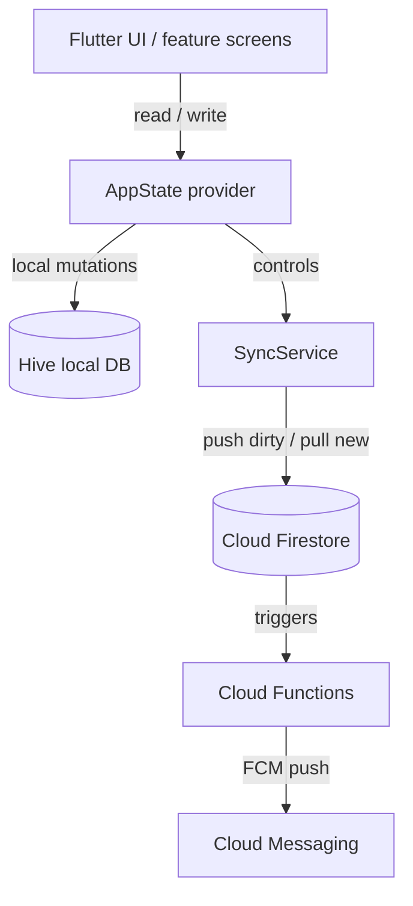

# Infrastructure

How NUmer runs and ships. For *what it does* see [PRODUCT.md](PRODUCT.md); for *where code
lives and how it's organized* see [AGENTS.md](../AGENTS.md). This file is the single source of
truth for the runtime system, backend, and build/deploy.

## Architecture — offline-first client/server



The app stores **everything locally in Hive first**. Local entities are marked `dirty` on
change and `SyncService` pushes them to Firestore when online. A local change only pushes. Remote
changes since the last sync timestamp are pulled on launch, on first bootstrap, on a manual sync
and on resume when the last pull is at least 10 minutes old (or none has happened yet). A reconnect
runs a full pull if none has happened in this session or the session began with a bootstrap. There
is no background timer. A sync requested while another is running runs after it. It also runs a
heartbeat to claim/verify active timers across devices, which also records the app's build
number as `users/{uid}.appBuild`.
Data flow, end to end:

1. User acts in a feature screen → mutates `AppState`.
2. `AppState` writes to Hive via `core/data/storage.dart` (`dirty = true`, `updatedAt` set).
3. `SyncService` uploads dirty records to Firestore.
4. A Firestore trigger (e.g. `onStudySessionWrite`) recomputes group aggregates/leaderboards.
5. Updated aggregates stream back and render in the group dashboard.

**Never write to Firestore directly from UI** — always go through Hive + `SyncService`.

## Client stack

| Area | Choice |
|------|--------|
| Framework | Flutter (Dart SDK ≥ 3.10) |
| State management | `provider` + `ChangeNotifier` (`app/app_state.dart`) |
| Local persistence | `hive` / `hive_flutter` + `shared_preferences` |
| Charts / calendar | `fl_chart`, `table_calendar` |
| Notifications | `flutter_local_notifications`, `firebase_messaging`, `timezone` |
| Export | `excel` (`.xlsx`), plus `.csv` / `.ics` generation |
| Firebase SDKs | `firebase_core`, `firebase_auth`, `cloud_firestore`, `cloud_functions`, `firebase_messaging`, `firebase_app_check` |

The app version is set in `pubspec.yaml`. Icons are generated via
`flutter_launcher_icons` from `assets/icon/app_icon.png`.

## Firebase

Production project: **`numer-60744`**; staging has its own, see [Environments](#environments)
(`.firebaserc`, `firebase.json`).

- **Auth** — email/password, with the address verified by an emailed 6-digit code.
- **Firestore** — primary cloud store (rules in `firestore/firestore.rules`, indexes in
  `firestore/firestore.indexes.json`; paths wired via `firebase.json`).
- **Cloud Functions** — Node.js 22 / TypeScript in `functions/` (source `functions/src/`, one folder per area,
  re-exported by `functions/src/index.ts`).
- **Cloud Messaging (FCM)** — nudge push notifications.
- **Crashlytics** — crash reports from release builds only, tagged with the uid and nothing
  else about the user, sent through `core/observability/`. Collection is off in
  `AndroidManifest.xml` and `Info.plist`, and the app turns it on at runtime.
- **App Check** — activated by the app in release builds, and in other builds only with
  `--dart-define=ENABLE_APPCHECK=true`, which uses the debug provider (`app/bootstrap.dart`).
  The email code callables enforce it by default; the other callables only when listed (see
  [Cloud Functions](#cloud-functions-functionssrc)).
- Dart config in `lib/core/firebase_options.dart`, first generated by FlutterFire (the `flutter`
  block in `firebase.json`) and now edited by hand: regenerating it would drop the staging options.

### Firestore data model

Top-level collections and the per-user subcollection tree (owner read/write unless noted;
see `firestore/firestore.rules` for exact access). "Peers" means a signed-in user who shares a
group with the owner according to `groupIndex`, never according to `users.groupIds`:

```
/groups/{groupId}                      group metadata; creator/admin edit, count steps by one
  /members                             creator promotes/demotes; nobody but the creator removes the creator
  /invites, /secrets, /aggregates, /stats, /leaderboard
/users/{userId}                        profile; any signed-in user may get one, nobody may list
/email_index/{emailId}                 email → uid lookup written only by older app versions, no reads
/groupIndex/{userId}                   server-written: groups the user belongs to; owner get only
/publicProfiles/{userId}               server-written: profile fields peers may get
/nudges/{nudgeId}                      server-written; receiver reads and sets status 'delivered'
/config/{docId}, /feed/{docId}         server-written; any signed-in user may get
/mailQueue, /nudgeLimits, /joinAttempts, /authCodes, /authRateLimits, /authAudit,
/deletedUsers, /accountEvents, /announcements, /feedState, /roleAudit
                                       server only, denied to every client
/users/{userId}/
  fcmTokens, aggregates (peers read), aggState (server only), sessions (peers read,
  seconds at most 604800), studySessions, courses (peers read), studyTimes,
  courseGoals, courseProgress, goals, reflections, preferences, aiLogs,
  stats, meta, groupMemberships, nudgeCooldowns,
  habits (+ /history), habit_categories, connections, connectionGroups
```

### Remote flags and minimum build

`config/app` is edited only in the console or with the Admin SDK:

```
minSupportedBuild: int
modules: { <id>: { enabled: bool, rollout: 0..100, allow: [uid], minBuild: int } }
```

A module is visible when `enabled`, the app build is at least `minBuild`, and the uid is in
`allow` or its stable hash modulo 100 is below `rollout`. A missing document or field turns
modules off, and a module entry with a field of the wrong type is ignored. A build below
`minSupportedBuild` shows only the update-required screen. This binds only versions that
contain the check.

`AppConfigService` (`core/config/`) starts from the copy cached on the device and never delays
startup. It reads the document from the server when a user is signed in at launch, on sign-in
and on resume, at most once in 6 hours after a successful read. While the update-required
screen is shown it reads again on every resume and every 60 seconds while the app is visible,
without that limit, and the screen closes as soon as the build is allowed. No feature is gated
by a flag yet.

### Cloud Functions (`functions/src/`)

| Type | Name | Purpose |
|------|------|---------|
| Firestore trigger | `onStudySessionWrite` | Recompute user/group aggregates on session change |
| Firestore trigger | `onCourseWrite` | Recompute aggregates when course visibility changes |
| Firestore trigger | `onGroupMemberDelete` | Clean up membership associations |
| Firestore trigger | `onMailQueued` | Render and send a queued email |
| Firestore trigger | `onGroupMemberWrite` | Maintain `groupIndex` from member create and delete, retried on failure |
| Firestore trigger | `onUserProfileWrite` | Mirror public profile fields into `publicProfiles`, retried on failure |
| Firestore trigger | `onUserDeletionRequested` | Purge a user marked in `deletedUsers`, retried on failure |
| Scheduled | `sweepDeletedUsers` | Daily: remove what a signed-in device wrote after a purge |
| Firestore trigger | `onAccountEventCreated` | Deliver a new account event to the module backends |
| Scheduled | `retryAccountEvents` | Every 15 minutes: retry account events that are due |
| Scheduled | `composeFeedScheduled` | Every 30 minutes: rebuild `feed/current` |
| Firestore trigger | `onAnnouncementWrite` | Rebuild `feed/current` when an announcement changes |
| Callable | `deleteGroupCallable` | Recursively delete group, members, aggregates |
| Callable | `deleteAccountCallable` | Disable the auth user and mark it in `deletedUsers` for the purge |
| Callable | `joinPrivateGroup` | Transactionally validate join code and add member |
| Callable | `sendNudge` | Persist nudge + FCM push with localized phrase |
| Callable | `setUserRoles` | Administrator sets a user's module roles (see [Roles](#roles)) |
| Callable | `publishAnnouncement`, `retractAnnouncement` | An editor publishes or retracts a news announcement (see below) |
| Callable | `sendEmailVerificationCode`, `verifyEmailCode` | Email and verify a 6-digit code that marks the signed-in user's email verified |
| Callable | `requestPasswordResetCode`, `verifyPasswordResetCode`, `confirmPasswordReset` | Queue a 6-digit reset code, trade it for a single-use ticket, set the new password |

Callables require a signed-in user, except the three password reset ones. Outside the email
code callables (below), App Check is off by default and switched on per callable:
list export names, comma-separated, in `APPCHECK_ENFORCED` in `functions/.env` (`*` means all;
`functions/.env.example` shows the key), then deploy functions. A listed callable rejects a
request without a valid App Check token with `failed-precondition` and reason `app-check`.

Transactional email (`functions/src/mail/`) renders the `verify`, `reset` and
`passwordChanged` templates in EN, RU and KK. Callers send through `MailSender`, or queue with
`enqueueMail` when they must not wait for delivery. A delivered entry is deleted. A failed one
is stripped of its address and code.

Email codes (`functions/src/auth/`) replace Firebase's email links. A code lives 10 minutes,
allows 5 attempts and a resend after 60 seconds; it is stored only as an HMAC keyed by the
`AUTH_CODE_SECRET` secret in `authCodes`, with fixed-window counters in `authRateLimits` and
one `authAudit` row per call that passes the input checks (hashes only). The reset request
answers the same whether or not the account exists and sends through `mailQueue`; the
verification send is inline. Errors carry `details.reason` for the client. All five callables
enforce App Check unless `AUTH_ENFORCE_APPCHECK=off` in `functions/.env`; the per-IP limits are
secondary. Verification and reset each have their own 2,000 sends a day cap, which a caller who
gets past App Check can use up for that flow only. The three reset callables also consume the
App Check token and refuse a reused one with reason `app-check`, so the client must call them
with limited-use tokens.

`AGG_INCREMENTAL` (`on` or `off`, default `off`) switches the two aggregate triggers from the
full recompute to a per-user ledger in the private `users/{uid}/aggState/v1`, which costs about
4 reads per event instead of about 111. With the switch `off`, `AGG_SHADOW_PERCENT` (0 to 100,
default 0) also runs that share of users through the ledger without publishing and logs
`aggregate_shadow_mismatch` when its payload differs; both are set in `functions/.env`
(see `functions/.env.example`).

Account deletion: the client re-authenticates with the password, then `deleteAccountCallable`
disables the Auth user, revokes its refresh tokens and creates `deletedUsers/{uid}` (`pending`,
expires after 30 days). `onUserDeletionRequested` runs `purgeUser`: memberships and owned
groups, `users/{uid}` and its subtree, nudges, `email_index`, `authCodes`, `publicProfiles`,
`groupIndex`, the Auth user, then `accountEvents/deleted_{uid}` for module backends, and marks
the marker `done`. Every step is idempotent; a second call while `pending` sets
`retryRequestedAt` and runs the purge again. Triggers never re-create a user's documents: they
`update` and stop on a missing document. `sweepDeletedUsers` deletes, once more, the subtree
and mirrors of users purged more than 2 hours earlier, because another device's ID token stays
valid for up to an hour. Until the purge finishes the same email cannot sign up again.
`DELETE_REQUIRES_RECENT_AUTH=on` in `functions/.env` makes the callable require a sign-in from
the last 5 minutes; it stays `off` while older app versions cannot re-authenticate.

News (`functions/src/feed/`): the callables require `numer:editor` in both the caller's token
and their current claims, and write `announcements/{id}`, the source of truth: `title` (EN,
optional RU and KK, at most 100 characters each), optional `body` (400 each), `pinned`,
optional `link` (`https`, ASCII, at most 300 characters) and `expiresAt` (at most 365 days ahead), `publishedAt`,
`authorUid` and `retracted`. Without the app, `npm run feed:publish -- --file <json>` or
`-- --retract <id>`, with an optional `--dry-run`, does the same in `functions/` (needs
`GOOGLE_APPLICATION_CREDENTIALS`).

The composer writes the one document clients read, `feed/current` (`items`, `composedAt`,
`eventsOk`): at most 30 items, the newest two pinned announcements first, then newest first by
`publishedAt`. Retracted and expired announcements are left out, and an expired one leaves on
the next run. The items stay within 96 KB of JSON: past that, the oldest unpinned ones are
left out. Events come from the Events backend's public list at `FEED_EVENTS_URL` in
`functions/.env.<project id>`, a URL up to and including `/api/events`; empty means
announcements only. Ended and past events are left out, as are events with a title or location
over 100 characters or a token that is not 1 to 64 letters, digits, `_` or `-`. An event's
`publishedAt` is when the composer first saw it, kept in the server-only `feedState/events`
until the event starts (at most 300 events). If the list cannot be read, the previous events
stay and `eventsOk` is `false`. The composer reads and writes in one transaction, and a run
whose fetch is older than the stored one leaves the events as they are. `composeFeedScheduled` creates one Cloud Scheduler job on deploy, the
third besides those of `sweepDeletedUsers` and `retryAccountEvents`.

The app (`lib/features/news/`) reads `feed/current` from the server only, keeps the items in
the order written and caches them in `SharedPreferences` (`news_feed_v1`). It reads when
Home opens and the cache is at least 30 minutes old, and on a pull to refresh or the refresh
and retry buttons.

AI course analysis is paused: its callable has been removed and the app shows a coming-soon
screen.

## Backends

Campus modules run as separate backends, each in its own repository, which describes it in
detail. No database is shared between them or with NUmer: each module that stores data keeps
its own.

| Backend | Purpose | Storage | Repository | Health path |
|---------|---------|---------|------------|-------------|
| Gradus | courses, grades and GPA | none, the service is stateless | [Gradus](https://github.com/anxchywl/Gradus) | `/health/ready` |
| Clavis | piano room booking | SQLite | [Clavis](https://github.com/anxchywl/Clavis) | `/health/ready` |
| EventsBot | campus events and their moderation | PostgreSQL, with Redis for sessions and caches | [EventsBot](https://github.com/anxchywl/EventsBot) | `/health/ready` |
| Muto | student marketplace | PostgreSQL and S3-compatible object storage | [Muto](https://github.com/anxchywl/Muto) | `/health/ready` |

## Identity

A module backend takes the NUmer user's Firebase ID token as the bearer token and verifies it
itself with `numer_identity` (`backend/numer_identity/`), which checks:

- an RS256 signature made by one of Google's public signing keys
- the issuer and audience of the configured Firebase project
- the expiry, issue and sign-in times, with 30 seconds of leeway
- a subject of 1 to 128 characters, which is the Firebase uid
- no tenant, and a sign-in provider other than `anonymous` or `custom`
- a verified email address, unless the backend turns that check off

The full table, the error codes and the key caching are in its
[README](../backend/numer_identity/README.md).

A backend installs the library as a git dependency with that subdirectory, pinned to a tag
`identity-v<version>`, so its image build needs `git`
([install](../backend/numer_identity/README.md#install)).

The project id is backend configuration. The staging project has its own, so its tokens carry a
different issuer and audience, and a backend accepts the tokens of one project only.

## Roles

Module roles live only in the `numer_roles` custom claim of the ID token, a list of strings.
The allowed values are defined in [roles.ts](../functions/src/roles/roles.ts), and any other
value grants nothing:

| Role | Grants |
|------|--------|
| `clavis:operator` | operator access in Clavis |
| `events:admin` | administration in EventsBot |
| `gradus:operator` | operator access in Gradus |
| `muto:admin` | administration in Muto |
| `numer:admin` | assigning roles |
| `numer:editor` | publishing and retracting news announcements |

The first administrator is created locally with
`npm run roles:set -- --uid <uid> --roles <comma list> [--dry-run]` in `functions/` (needs
`GOOGLE_APPLICATION_CREDENTIALS`). Afterwards administrators call `setUserRoles`, which
requires `numer:admin` in both the caller's token and their current claims, and refuses to
remove the caller's own `numer:admin`.

A change reaches a client on its next token refresh. Removing a role also revokes the user's
refresh tokens, but an ID token issued earlier keeps the role for up to 1 hour in a module
backend that gives `numer_identity` no `revocation_check`.

`setUserRoles` logs each call to `roleAudit`, which clients cannot access. The entry is
written after the claims change, so a failed write leaves that change unlogged, and the
script writes no entry.

## Account events

A deleted NUmer account must be deleted in every module backend too
(`functions/src/account/`). The purge creates `accountEvents/deleted_{uid}`
(`{type, issuer, subject, occurredAt, status, nextAttemptAt}`), and the functions deliver it to
each target. The scheduled run also takes `pending` events that have no `nextAttemptAt`.

- Targets: `ACCOUNT_EVENT_TARGETS` in the git-ignored `functions/.env.<project id>`, a JSON
  list of `{"module": ..., "url": ...}` with `module` one of `clavis`, `events` or `muto` and
  an `https` URL (`http` to `127.0.0.1` or `localhost` in the emulator only). An invalid value
  fails the deploy.
- Secrets: `ACCOUNT_EVENTS_SECRET_<MODULE>`, one per module. The two functions declare only the
  secrets of listed modules, so create a module's secret before listing it, then deploy
  functions. A deploy fails while a declared secret is missing.
- Request: `POST <url>` with `{"id", "type", "issuer", "subject", "occurredAt"}` (ISO 8601)
  and the header `X-Numer-Signature: t=<unix seconds>,v1=<hex>`, where the hex is
  `HMAC-SHA256(secret, "<t>.<raw body>")` and `t` is the time of that attempt. `type` is `account.deleted`; `account.disabled` is
  defined but not sent yet.
- Any 2xx answer within 10 seconds is success. A redirect is not followed and counts as a
  failure.
- Retries wait 15 minutes, 30 minutes, 1 hour, 2 hours, 4 hours, then 6 hours, rounded up to
  the 15 minute schedule. At the first failed attempt 72 hours or more after `occurredAt` the
  target and the event become `failed` and `account_event_delivery_failed` is logged once
  per target. A failed event is not retried.
- Progress is kept per module under `deliveries.<module>`. An event processed while no target
  is listed becomes `unrouted` and `account_event_unrouted` is logged. It is kept but never sent
  automatically, so list a module before it stores user data. An event already `delivered` to
  other modules is not sent to a module added later.

A module handler must verify the signature over the raw body with
[`numer_identity.verify_account_event`](../backend/numer_identity/README.md#account-events)
(5 minute tolerance), treat `id` as an idempotency key,
answer 2xx for an event it has already processed, and for that `issuer` and `subject` delete
the data on `account.deleted` and only block access on `account.disabled`.

## Operations

Scripts in `infra/` that the owner runs on the module host.

- **Restore test**: `infra/backup/restore-test.sh` restores the newest backup of a module into
  a throwaway container and logs the result ([README](../infra/backup/README.md)).
- **Monitor**: `infra/monitor/` checks the module APIs, backup age and the restore-test log,
  posts alerts to a webhook and pings an outside heartbeat
  ([README](../infra/monitor/README.md)).
- **Host scripts**: `infra/host/` audits the host and applies one hardening step at a time
  ([runbook](../infra/RUNBOOK.md)).

## Environments

`APP_ENV` (`production` by default, or `staging`) picks the Dart Firebase options. On Android the
native config file also initialises the default app, so it must be switched together with
`APP_ENV`: a mismatch fails Firebase initialisation.

| Environment | Run the app | Deploy functions and rules | Config files (git-ignored) |
|-------------|-------------|----------------------------|----------------------------|
| Emulator | `./scripts/use_firebase_env.sh staging`, then `flutter run --dart-define-from-file=env/staging.json --dart-define=USE_FIRESTORE_EMULATOR=true` | nothing to deploy, the emulators read the working tree | `functions/.secret.local`, `functions/.env.local` and the staging files |
| Staging | `./scripts/use_firebase_env.sh staging`, then `flutter run --dart-define-from-file=env/staging.json` | `./scripts/deploy_staging.sh` (`DRY_RUN=1` prints the command) | `env/staging.json`, `functions/.env.<staging id>`, `*.staging.*` native files |
| Production | `./scripts/use_firebase_env.sh production`, then `flutter run` with `--dart-define` for `FIREBASE_ANDROID_API_KEY` and `FIREBASE_IOS_API_KEY` | by the owner, by hand: `firebase deploy --project default` | `functions/.env.numer-60744`, `*.production.*` native files |

- The native files live beside the ones the build reads:
  `android/app/google-services.<env>.json` and `ios/Runner/GoogleService-Info.<env>.plist`. The
  script copies both over `google-services.json` and `GoogleService-Info.plist`. A production
  file with no saved copy is saved first, and the script refuses to switch when the active and
  saved production files differ.
- Create `env/staging.json` from `env/staging.example.json`. The values come from
  `firebase apps:sdkconfig` for the staging apps; the storage bucket and the API keys must equal
  those in the native files. A staging build refuses the production project id.
- Before the first staging deploy, set the `MAIL_API_KEY` and `AUTH_CODE_SECRET` secrets in that
  project. The deploy script refuses a missing alias, the production id and a missing env file.
- Staging normally runs in debug. A staging release build needs App Check registered for the
  staging apps.

### Emulators

```bash
cp functions/.secret.local.example functions/.secret.local
```

```bash
./scripts/start_emulators.sh
```

- The copy is made once. Without `functions/.secret.local` the Functions emulator reads the
  declared secrets from the project's Secret Manager, so a bare `firebase emulators:start`, which
  runs as the production project, would load production secrets and send real mail. Always use the
  script (`npm start` in `functions/` runs it): it runs under the staging project id and refuses
  to start until every secret in the example file is set.
- For the email code flows, put `MAIL_PROVIDER=console` and `AUTH_ENFORCE_APPCHECK=off` in the
  git-ignored `functions/.env.local`. No mail is sent; the log shows only the subject, so the code
  itself cannot be read there.
- `USE_FIRESTORE_EMULATOR=true` points Auth (9099), Firestore (8080) and Functions (5001) at
  `localhost` and skips App Check. Other Firebase services, such as Cloud Messaging, still reach
  the project in the app's options.
- Run the app with the staging defines: with production options its project id differs from the
  emulators' and its function calls do not reach them.
- A release build with `APP_ENV=production` refuses to start with the switch on.
- On Android the Firebase plugins replace `localhost` with `10.0.2.2`, which reaches the host
  from an Android emulator only. Because of that, `adb reverse tcp:8080 tcp:8080` (and the same
  for 5001 and 9099) does not connect a physical Android device.

## Native platforms

- **iOS** (`ios/`) — includes the **Session Live Activity** widget extension
  (`ios/SessionLiveActivityExtension/`) and shared attributes (`ios/Shared/`), logically owned
  by the `sessions` feature.
- **Android** (`android/`) — adaptive launcher icons; `minSdk` follows
  `flutter.minSdkVersion`.
- **macOS** (`macos/`).

Native project files (`Podfile`, `*.xcodeproj/xcworkspace`, Gradle, `google-services.json`,
`GoogleService-Info.plist`) are tool-owned — do not restructure them.

## Localization

`flutter gen-l10n` (config in `l10n.yaml`) generates `lib/l10n/app_localizations*.dart` from
ARB files `app_en.arb` (template), `app_ru.arb`, `app_kk.arb`. Retrieve strings via
`AppLocalizations.of(context)`. Generated Dart is not hand-edited.

## Build, run, deploy

```bash
# setup
flutter pub get
(cd functions && npm install)

# run the app (simulator/emulator running)
flutter run

# quality gates, the script header lists what it does not run
./scripts/verify.sh

# release builds
flutter build ios
flutter build appbundle
flutter build macos

# Cloud Functions: unit tests, then rules and emulator tests (needs Java 21)
(cd functions && npm test)
(cd functions && npm run test:emulator)
```

Emulators and deploys are covered in [Environments](#environments).

### CI
- `.github/workflows/ci.yml` runs on pull requests and pushes to `main`: `./scripts/verify.sh`
  and the `numer_ui` checks, the functions emulator tests, and shellcheck with the host, backup
  and monitor script tests.
- `.github/workflows/identity.yml` runs `backend/numer_identity/scripts/verify.sh` (ruff,
  mypy strict, pytest with a 95% coverage floor) on Python 3.12 when a pull request or a
  push to `main` touches `backend/numer_identity/**`.

### Secrets & config
- Platform Firebase config files (`google-services.json`, `GoogleService-Info.plist`) live in
  their platform dirs and are git-ignored.
- `MAIL_API_KEY` is a Secret Manager secret bound to `onMailQueued`; it must exist in a
  project before functions are deployed there.
- `MAIL_FROM` and `MAIL_PROVIDER` (`resend`, or `console` outside production) come from a
  git-ignored `functions/.env.<project id>`; `functions/.env.example` lists them.
- Send a test email with `(cd functions && npm run build && npm run mail:test -- --to
  <address> --template verify --locale en)`, with the three variables in the environment.

## Key files
- App shell: `lib/app/` (entry `bootstrap.dart`, root widget `numer_app.dart`, tabs `shell/`)
- App state: `lib/app/app_state.dart`
- Local storage / sync: `lib/core/data/storage.dart`, `lib/core/data/sync_service.dart`
- Remote flags: `lib/core/config/`
- Upcoming items (device-local, cleared on sign-out and account deletion):
  `lib/core/upcoming/`
- Module registry and session contract: `lib/app/modules/`, `lib/core/modules/`,
  `lib/core/identity/`
- Crash reporting: `lib/core/observability/`
- Performance budgets and measuring scripts: [PERFORMANCE.md](PERFORMANCE.md)
- Notifications: `lib/core/notifications/`
- Backend: `functions/src/`, `firestore/firestore.rules`, `firebase.json`
