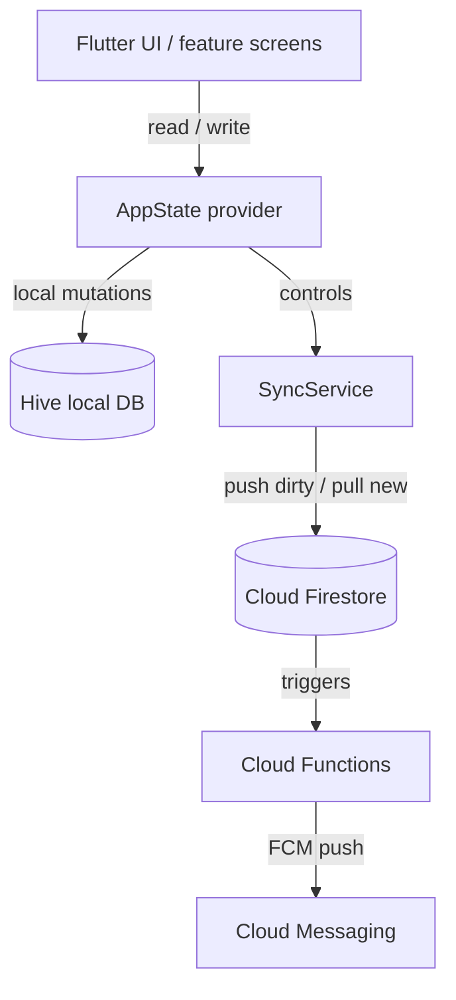

# Infrastructure

How NUmer runs and ships. For *what it does* see [PRODUCT.md](PRODUCT.md); for *where code
lives and how it's organized* see [AGENTS.md](../AGENTS.md). This file is the single source of
truth for the runtime system, backend, and build/deploy.

## Architecture — offline-first client/server



The app stores **everything locally in Hive first**. Local entities are marked `dirty` on
change; `SyncService` pushes them to Firestore when online and pulls remote changes since the
last sync timestamp. It also runs a heartbeat to claim/verify active timers across devices.
Data flow, end to end:

1. User acts in a feature screen → mutates `AppState`.
2. `AppState` writes to Hive via `core/data/storage.dart` (`dirty = true`, `updatedAt` set).
3. `SyncService` uploads dirty records to Firestore.
4. A Firestore trigger (e.g. `onStudySessionWrite`) recomputes group aggregates/leaderboards.
5. Updated aggregates stream back and render in the group dashboard.

**Never write to Firestore directly from UI** — always go through Hive + `SyncService`.

## Client stack

| Area | Choice |
|------|--------|
| Framework | Flutter (Dart SDK ≥ 3.4.0) |
| State management | `provider` + `ChangeNotifier` (`app/app_state.dart`) |
| Local persistence | `hive` / `hive_flutter` + `shared_preferences` |
| Charts / calendar | `fl_chart`, `table_calendar` |
| Notifications | `flutter_local_notifications`, `firebase_messaging`, `timezone` |
| Export | `excel` (`.xlsx`), plus `.csv` / `.ics` generation |
| Firebase SDKs | `firebase_core`, `firebase_auth`, `cloud_firestore`, `cloud_functions`, `firebase_messaging`, `firebase_app_check` |

App version: `1.0.3+32` (see `pubspec.yaml`). Icons are generated via
`flutter_launcher_icons` from `assets/icon/app_icon.png`.

## Firebase

Project: **`numer-60744`** (see `.firebaserc`, `firebase.json`).

- **Auth** — email/password with verification.
- **Firestore** — primary cloud store (rules in `firestore/firestore.rules`, indexes in
  `firestore/firestore.indexes.json`; paths wired via `firebase.json`).
- **Cloud Functions** — Node.js 20 / TypeScript in `functions/` (source `functions/src/`, one folder per area,
  re-exported by `functions/src/index.ts`).
- **Cloud Messaging (FCM)** — nudge push notifications.
- **App Check** — enforced in release; debug provider in debug builds (`main.dart`).
- Dart config generated at `lib/core/firebase_options.dart` (wired via the `flutter` block in
  `firebase.json`).

### Firestore data model

Top-level collections and the per-user subcollection tree (owner read/write unless shared via
a group; see `firestore.rules` for exact access):

```
/groups/{groupId}                      group metadata
  /members, /invites, /secrets, /aggregates, /stats, /leaderboard
/users/{userId}                        profile (name, major, goals, prefs)
/email_index/{emailId}                 email → uid lookup
/users/{userId}/
  fcmTokens, aggregates, sessions, studySessions, courses, studyTimes,
  courseGoals, courseProgress, goals, reflections, preferences, aiLogs,
  stats, meta, groupMemberships, nudgeCooldowns,
  habits (+ /history), habit_categories, connections, connectionGroups
```

### Cloud Functions (`functions/src/`)

| Type | Name | Purpose |
|------|------|---------|
| Firestore trigger | `onStudySessionWrite` | Recompute user/group aggregates on session change |
| Firestore trigger | `onCourseWrite` | Recompute aggregates when course visibility changes |
| Firestore trigger | `onGroupMemberDelete` | Clean up membership associations |
| Firestore trigger | `deleteGroup` | Cascade group cleanup |
| Callable | `deleteGroupCallable` | Recursively delete group, members, aggregates |
| Callable | `deleteAccountCallable` | Delete auth user + subcollections + memberships |
| Callable | `joinPrivateGroup` | Transactionally validate join code and add member |
| Callable | `getMemberSubjectStats` | Per-subject study breakdown for a group member |
| Callable | `sendNudge` | Persist nudge + FCM push with localized phrase |

Callables enforce authentication and App Check.

AI course analysis is paused: its callable has been removed and the app shows a coming-soon
screen.

## Native platforms

- **iOS** (`ios/`) — includes the **Session Live Activity** widget extension
  (`ios/SessionLiveActivityExtension/`) and shared attributes (`ios/Shared/`), logically owned
  by the `sessions` feature (see `lib/features/sessions/README.md`).
- **Android** (`android/`) — adaptive launcher icons, `minSdk 21`.
- **macOS** (`macos/`).

Native project files (`Podfile`, `*.xcodeproj/xcworkspace`, Gradle, `google-services.json`,
`GoogleService-Info.plist`) are tool-owned — do not restructure them.

## Localization

`flutter gen-l10n` (config in `l10n.yaml`) generates `lib/l10n/app_localizations*.dart` from
ARB files `app_en.arb` (template), `app_ru.arb`, `app_kk.arb`. Retrieve strings via
`AppLocalizations.of(context)`. Generated Dart is not hand-edited.

## Build, run, deploy

```bash
# setup
flutter pub get
(cd functions && npm install)

# run the app (simulator/emulator running)
flutter run

# quality gates, the script header lists what it does not run
./scripts/verify.sh

# release builds
flutter build ios
flutter build android
flutter build macos

# Cloud Functions: local emulator
(cd functions && npm run build) && firebase emulators:start --only functions,firestore,auth

# Cloud Functions: unit tests, then rules and emulator tests (needs Java 21)
(cd functions && npm test)
(cd functions && npm run test:emulator)

# deploy
firebase deploy --only firestore:rules
firebase deploy --only functions
```

### Secrets & config
- Platform Firebase config files (`google-services.json`, `GoogleService-Info.plist`) live in
  their platform dirs and are git-ignored.

## Key files
- App state: `lib/app/app_state.dart`
- Local storage / sync: `lib/core/data/storage.dart`, `lib/core/data/sync_service.dart`
- Notifications: `lib/core/notifications/`
- Backend: `functions/src/`, `firestore/firestore.rules`, `firebase.json`

## Known follow-ups (technical debt)

Deferred intentionally to keep the shipping app stable — tackle incrementally:

- Decompose the large `app/app_state.dart` `ChangeNotifier` into per-feature controllers.
- Split `main.dart` into `app/bootstrap.dart`, `app/router.dart`, `app/app.dart`.
- Break `core/data/storage.dart`'s imports of feature models (`courses`, `habits`,
  `sessions`) so `core` no longer imports a feature.
- Repair and unskip `test/features/account/accent_color_picker_test.dart` (pre-existing
  failure — slider-label assertions no longer match the widget).
