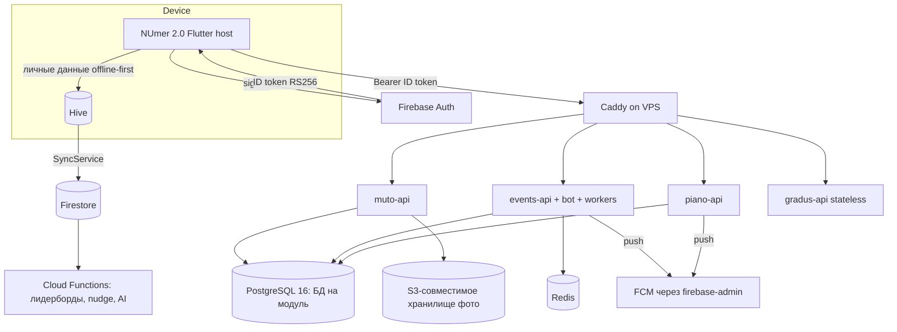

# NUmer 2.0 — стратегия суперапа

Дата: 2026-11-26. Основа: анализ этого репозитория и репозиториев `anxchywl/Muto`,
`anxchywl/EventsBot`, `anxchywl/Clavis`, `anxchywl/Gradus` (плюс беглый взгляд на `Wished`,
`Iter`, `Loci`).

## TL;DR

1. **Масштаб не проблема.** 500 пользователей — это ~50 одновременных и единицы-десятки RPS
   в пике. И Firebase, и один VPS с PostgreSQL выдерживают это с запасом в 10–50 раз.
   Решение про БД надо принимать не из-за нагрузки, а из-за **формы данных и интеграции модулей**.
2. **Не переписывать NUmer с Firebase на свою БД сейчас.** Личные данные (привычки, сессии,
   курсы) идеально ложатся на текущую схему Hive → Firestore, она работает у 200 человек.
   Переезд = переписать `sync_service.dart` (1320 строк), мигрировать пользователей и рискнуть
   релизом в сторах ради нуля пользы для студента.
3. **Гибрид:** Firebase остаётся **identity-провайдером** (Auth) и хранилищем личных
   offline-first данных NUmer. Все «кампусные» модули (маркет, ивенты, пиано-рум) живут на
   **одном PostgreSQL** за своими FastAPI-сервисами — они уже так написаны.
4. **Главный недостающий кусок — единый вход.** Все четыре модуля уже спроектированы как
   встраиваемые Flutter-фичи, которые ждут от хоста bearer-токен (`MutoHostSession`,
   `EventsHostSession`, `PianoRoomScope`, `GradusScope`), а бэкенды ждут «host auth adapter».
   Этим хостом становится NUmer, а токеном — **Firebase ID token** (RS256, публичные ключи
   Google). Это одна общая Python-библиотека на ~100 строк + адаптер в каждом сервисе.
5. Порядок встраивания: **Gradus → Clavis → Events → Muto** (от низкого риска к высокому).

---

## 1. Что есть сейчас

### 1.1 NUmer (хост)

| Что | Состояние |
|---|---|
| Клиент | Flutter, Dart ≥3.4, `provider`, Hive (hand-written адаптеры, typeId 10–17), ~53k строк |
| Бэкенд | Firebase: Auth (email+verify), Firestore, 10 Cloud Functions (Node 20/TS), FCM, App Check |
| Данные | `/users/{uid}/...` — ~20 подколлекций (sessions, courses, habits+history, goals, aiLogs…), `/groups` с агрегатами для лидербордов |
| Модель синка | Hive first → `dirty=true` → `SyncService` пушит/пуллит по `updatedAt` + heartbeat активного таймера |
| Пользователи | 200+ активных, App Store + Google Play, v1.0.3 |
| Техдолг (из INFRASTRUCTURE.md) | `app_state.dart` 2637 строк, `main.dart` 1171 строка, `core` импортирует фичу, сломанный тест |

Архитектура feature-first уже готова к росту: новые модули ложатся в `lib/features/<name>/`
или подключаются как пакеты.

### 1.2 Модули

| Модуль | Что делает | Клиент | Бэкенд | Хранилище | Auth сейчас | Объём |
|---|---|---|---|---|---|---|
| **Gradus** | GPA-трекер, семестры, импорт силлабуса (PDF/Word → таблица оценок через LLM) | `gradus_feature` + `app_ui` | FastAPI, без БД, только парсинг силлабуса (Gemini/OpenAI/Anthropic) | `SharedPreferences` на устройстве | dev-токены | ~14k |
| **Clavis** | Бронирование Piano Room: слоты 09–22, лимит 2/нед, окно брони вс 21–22 | `piano_room_feature` + `app_ui` | FastAPI, идемпотентные брони, серверное время, operator-эндпоинты | **SQLite** (1 процесс) | dev-токены | ~8k |
| **EventsBot** | Ивенты: TG Mini App, бот с дашбордами в группах, модерация, напоминания, друзья, аналитика | `flutter_events` (координаторы) + vanilla JS Mini App | FastAPI + aiogram 3 + воркеры | **PostgreSQL** + Redis, Alembic (~30 миграций) | Telegram initData / NU-email / dev; есть **готовый `superapp_bridge`** (JWT, `users.superapp_user_id`) | ~56k |
| **Muto** | Маркетплейс: листинги, фото, поиск, избранное, репорты, контакт вне приложения | `muto_feature` → `muto_ui` → `app_ui` | FastAPI, cursors, image service | **PostgreSQL 16** + S3-совместимое хранилище фото | dev-токены; модель `ExternalIdentity(issuer, subject)` | ~28k |

Что важно и **хорошо**:

- Все модули — **встраиваемые фичи**: не создают `MaterialApp`, тему/локаль/идентичность
  берут у хоста, имеют `onSessionExpired`. Это ровно то, что нужно суперапу.
- Везде EN/RU/KK — совпадает с NUmer.
- Слои domain/application/data/presentation с тестами на границы; Docker Compose, Caddy,
  backup/restore/monitor-скрипты, gitleaks, CI.
- Muto уже деплоится на shared host рядом с Wished (`wished-proxy` сеть) — инфраструктура
  «несколько сервисов на одном VPS» у тебя уже есть.

Что **мешает** сразу встроить:

- **Нет реального auth.** Везде dev-токены; хоста, выдающего токены, не существовало (Jas Wallet).
- **Flutter SDK:** модули на Dart ^3.10 / Flutter 3.38.5, NUmer — `>=3.4`. Сначала апгрейд NUmer.
- **Три расходящиеся копии `app_ui`** (Events/Muto-версия богаче, Gradus/Clavis — форк),
  а у NUmer своя `shared/` и своя тема. Нужен один дизайн-пакет.
- Clavis на SQLite — не шарится между репликами, отдельный бэкап-контур.
- Gradus хранит транскрипт только на устройстве — при переустановке всё теряется.

---

## 2. Решение по базе данных

### 2.1 Почему «всё на свою БД» — не сейчас

| Аргумент «за свою БД» | Реальность |
|---|---|
| «Не выдержит рост» | Firestore масштабируется сам; 500 юзеров — копейки. Для ориентира: 500 DAU × ~500 чтений/день ≈ 250k чтений/день ≈ единицы долларов в месяц на Blaze (проверь актуальные цены в консоли). |
| «Данных станет больше» | Сессии/привычки — ~1–2 млн документов в год на 500 юзеров. Ок для Firestore. |
| «Нужны join'ы и сложные запросы» | Да — **для кампусных модулей** (листинги, брони, ивенты, модерация). Поэтому они и на Postgres. Личным данным NUmer join'ы не нужны. |
| «Vendor lock-in» | Реален, но лечится постепенно (см. §2.5), а не большим переписыванием. |

### 2.2 Почему не «всё в Firestore»

- Брони Clavis держатся на **partial unique index** (`one active booking per slot`) и транзакциях
  с серверным временем. Маркетплейс — фильтры/курсоры/полнотекст. Ивенты — модерация, аудит,
  append-only аналитика. Это реляционные задачи, и они **уже написаны** под SQL.
- Переписывать ~90k строк бэкендов под Firestore — бессмысленно.

### 2.3 Итоговая схема (гибрид)



Правила:

- **Глобальный ID пользователя = Firebase `uid`.** Каждый сервис хранит у себя `(issuer, subject)`
  → локальный `user_id` и автопровиженит пользователя при первом запросе. У Muto это уже
  `ExternalIdentity`, у Events — `superapp_user_id`.
- **Один Postgres-кластер, отдельная БД (или схема) и отдельная роль на модуль.** Никаких
  кросс-модульных join'ов в SQL — модули общаются только через `uid` и API. Так модуль можно
  вынести на отдельный сервер без переписывания.
- **Личные данные студента** (привычки, сессии, курсы, **оценки Gradus**) — в Firestore через
  существующий offline-first синк.
- **Кампусные общие данные** (листинги, ивенты, брони) — в Postgres, online-only, с кэшем на клиенте.

### 2.4 Сколько реально стоит Firebase

Цены по прайсу Blaze, который я знаю (проверь в консоли — регион и цены могли поменяться):
Auth email/password бесплатен до ~50k MAU; Firestore ≈ $0.06 за 100k чтений и $0.18 за
100k записей, первые 50k чтений и 20k записей в день бесплатны; Functions — 2M вызовов/мес бесплатно.

Самое дорогое место в коде сейчас — `onStudySessionWrite`
([functions/src/index.ts](../functions/src/index.ts)): **на каждую запись сессии** он заново
читает все курсы пользователя и все его сессии за 35 дней (обычно 50–150 документов), а потом
пишет агрегат в каждую группу. Стоимость растёт как `активность × размер истории`.

| Активных в день | Firestore + Functions, оценка | VPS для модулей |
|---|---|---|
| 200 | ~$0–5/мес (почти всё во free tier) | €10–20/мес фикс |
| 500 | ~$5–20/мес | те же €10–20 |
| 5 000 | ~$80–200/мес, если не поправить агрегаты | €20–40 |

Вывод: на 500 Firebase **не дорогой**, дорогим его делает паттерн «пересчитать всё на каждую
запись». Что сделать в фазе 0:

- **Бюджет-алерты** в Google Cloud Billing ($10 / $25 / $50) — бесплатно, сразу видно рост.
- **Инкрементальные агрегаты:** в триггере брать `before`/`after` документа и прибавлять дельту
  (`FieldValue.increment`) вместо перечитывания 35 дней. Раз в сутки — scheduled-функция
  пересчитывает «скользящие» окна (7 дней / месяц) для точности.
- Не писать в Firestore на каждый тик таймера — только старт/пауза/стоп.
- Слушатели (`snapshots()`, их 17) — только на открытом экране, с `limit`.
- Кампусные модули в Firestore **не переносить** — там чтения на ленту/поиск съели бы бюджет.

Если после этого счёт всё равно уверенно ползёт к $50+/мес — это триггер фазы 5 (§2.5).

### 2.5 Когда пересматривать (триггеры для фазы 5)

Переносить ядро NUmer в Postgres стоит, только если сработает хотя бы одно:

- счёт Firebase стабильно > ~$50/мес или растёт быстрее аудитории;
- нужна аналитика/фичи поверх личных данных + кампусных (например, «рекомендовать ивенты по
  предметам из курсов») и BigQuery-экспорт не спасает;
- **требование локализации персональных данных в РК** (см. §7) — если университет или
  партнёры потребуют, это главный реальный повод уехать с Firebase на сервер в Казахстане;
- 5k+ активных и тормозят лидерборды на Cloud Functions.

---

## 3. Единая идентичность (ключевая работа)

### 3.1 Flutter-сторона

Добавить в NUmer `core/identity/host_session_provider.dart`:

- отдаёт текущий `FirebaseAuth.instance.currentUser.getIdToken()` (кэш ~55 мин, Firebase сам
  обновляет);
- на `onSessionExpired` модуля → `getIdToken(true)` и пересоздание фичи с новой сессией
  (так описано в контрактах Muto/Events);
- при logout/смене аккаунта — пересоздание scope всех модулей (кэши не должны перетекать
  между аккаунтами — модули это уже поддерживают).

### 3.2 Бэкенд-сторона

Одна общая Python-библиотека `numer-identity` (отдельный репо или пакет, подключается через
`uv` git-зависимость):

- проверка подписи по JWKS `https://www.googleapis.com/service_accounts/v1/jwk/securetoken@system.gserviceaccount.com`
  (с кэшем ключей);
- `iss = https://securetoken.google.com/numer-60744`, `aud = numer-60744`, `exp`, `auth_time`;
- `email_verified == true` и домен `@nu.edu.kz` → `is_verified` (для маркета и ивентов это
  важно: «только верифицированные студенты»);
- роли (operator/coordinator/admin) — **custom claims** Firebase, выставляются Cloud Function'ой
  только из админки; клиенту не доверяем (это правило уже есть в AGENTS.md Gradus).

В каждом сервисе это один файл: `FirebasePrincipalResolver` рядом с `DevelopmentPrincipalResolver`
(Muto/Clavis/Gradus) и конфиг `SUPERAPP_JWT_*` в Events. Dev-режим остаётся под `APP_ENV != production`.

### 3.3 Насколько безопасно: вход в Firebase, данные в Postgres

Это стандартная схема «внешний IdP + свои API». Google прямо поддерживает проверку ID-токенов
сторонними бэкендами. По сравнению с собственным auth она скорее **безопаснее**: пароли,
защита от брутфорса и сброс пароля остаются у Google, и при взломе VPS пароли не утекут.
Безопасность держится на нескольких правилах:

| Угроза | Защита |
|---|---|
| Поддельный токен | Принимать только `RS256`, ключ по `kid` из JWKS Google; проверять `iss`, `aud = numer-60744`, `exp`, `iat`, непустой `sub`. Никаких `HS256`/`none`. Лучше брать `firebase-admin` (`auth.verify_id_token`), а не писать проверку руками |
| Токен из staging принят в prod | Отдельный Firebase-проект для staging → другой `aud`, prod его отвергнет |
| Заблокированный/удалённый юзер ещё ходит (ID token живёт 1 час) | Для чувствительных действий (публикация листинга, операторские действия) — `verify_id_token(check_revoked=True)`; при удалении/бане — `revoke_refresh_tokens` + fan-out в сервисы |
| Боты/скрипты бьют прямо в API | Слать **App Check**-токен (`X-Firebase-AppCheck`) и проверять его на бэкенде (`firebase_admin.app_check.verify_token`); плюс rate limit, который в модулях уже есть |
| Эскалация ролей | Роли — custom claims, ставятся только через Admin SDK из админки. Модульные права (бан в Muto, оператор пиано-рума) — источник правды в Postgres этого модуля, не в клиенте |
| Кража токена | Только HTTPS, токен в памяти (модули так и делают), не логировать заголовок `Authorization`, в Caddy вырезать его из access-логов |
| Внутренние эндпоинты (удаление аккаунта) | Не на публичном Caddy-роуте; отдельный сервисный секрет или OIDC-токен сервисного аккаунта Cloud Functions, не пользовательский токен |
| Рассинхрон: юзер удалён в Firebase, строки остались в Postgres | Fan-out при удалении + ночная сверка `uid` с Firebase Auth |
| Firebase Auth недоступен | Проверка токена **локальная** по закэшированным ключам — уже выданные токены работают; не получится только новый вход |

Чего **не** делать: не дублировать пароли или сессии в Postgres, не принимать `uid`/роль из
тела запроса, не давать модулям сервисный аккаунт Firebase с полными правами (только то, что
нужно: проверка токенов и FCM).

Lock-in по auth небольшой: `firebase auth:export` отдаёт хеши паролей (modified scrypt) с
параметрами, их можно импортировать в свой auth без сброса паролей.

### 3.4 Telegram

Events живёт и в Telegram. Привязка: в NUmer кнопка «Подключить Telegram» → deep link
`t.me/<bot>?start=<одноразовый код>` → бот связывает `telegram_id` с `superapp_user_id`.
Так избранное/регистрации из Mini App и из NUmer — одни и те же.

### 3.5 Удаление аккаунта

Apple требует полного удаления аккаунта из приложения. `deleteAccountCallable` должен
**веером** вызывать `DELETE /internal/users/{uid}` в каждом сервисе (сервисный токен), а не
только чистить Firestore. Сделать до релиза первого модуля.

---

## 4. Клиент: как встроить модули в NUmer

1. **Апгрейд тулчейна** NUmer до Flutter 3.38.5 / Dart 3.10 (как у модулей). Прогнать `flutter analyze`/тесты.
2. **Распил `main.dart`** на `app/bootstrap.dart`, `app/router.dart`, `app/app.dart` (уже в техдолге) —
   без этого добавлять вкладки больно.
3. **Один дизайн-пакет.** Взять самую полную версию `app_ui` (Events/Muto), сделать её
   отдельным репо `numer_ui` (или `app_ui`), смапить токены на тему NUmer (accent color, dark mode).
   Модули переключить на неё. NUmer `shared/widgets` постепенно туда же.
4. **Подключение модулей** — git-зависимости с тегами в `pubspec.yaml`:
   ```yaml
   muto_feature:
     git: { url: https://github.com/anxchywl/Muto, path: muto_feature, ref: v0.2.0 }
   ```
   Модули остаются в своих репо со своими CI и standalone-хостами. Монорепо — только если
   устанешь бампать теги.
5. **Обёртка в NUmer:** `lib/features/campus/` — хаб-экран с плитками модулей + по одному
   тонкому адаптеру `features/<module>_host/` (передаёт сессию, конфиг, локаль). Бизнес-логики
   модулей в NUmer нет.
6. **Feature flags** (Firebase Remote Config): каждый модуль включается отдельно, можно
   выкатить на 10% или только тестерам и мгновенно выключить без релиза.
7. **Ленивая инициализация** — `initializeEventsFeature()` и т.п. только при первом открытии
   вкладки, чтобы не ухудшить холодный старт (у тебя уже есть `startup_metrics.dart` — мерить им).

### Специфика по модулям

- **Gradus** — интегрировать глубже остальных: в NUmer уже есть курсы с кредитами. Оценки и
  семестры сделать расширением курсов NUmer (Hive + Firestore синк), а `gradus-api` оставить
  только для парсинга силлабуса. Это решает проблему «переустановка — всё потеряно». Заодно
  объединить LLM-вызовы: NUmer `analyzeCourseAi` (Gemini 2.0 Flash — устаревает, обновить) и
  Gradus (`gemini-3.1-flash-lite`).
- **Clavis** — перевести SQLite → Postgres (partial unique index переносится 1:1). Добавить
  operator-экран (сейчас только эндпоинты). Пуш-напоминание за 30 мин до слота через FCM.
- **Events** — в NUmer встраивается студенческая часть (лента/фильтры/избранное/регистрация).
  Сейчас Flutter-клиент — координаторский, студенческий UI — в JS Mini App. Нужен студенческий
  Flutter-экран (или WebView на Mini App как быстрый MVP). Напоминания: TG + FCM.
- **Muto** — самый рискованный (UGC). Для App Store (Guideline 1.2) нужны: фильтр контента,
  репорт (есть), **блокировка пользователя** и **реальные действия модерации** (сейчас «app does
  not make moderation decisions») + контакт для жалоб. Без этого ревью может завернуть весь NUmer.

---

## 5. Инфраструктура под 500 (и 5000) пользователей

### 5.1 Оценка нагрузки

| Метрика | 500 юзеров | Запас одного VPS 4 vCPU/8 GB |
|---|---|---|
| Одновременно онлайн (пик ~10–15%) | 50–75 | тысячи |
| RPS в пике (кампусные API) | 10–50 | FastAPI+PG: сотни–тысячи простых запросов/с |
| Postgres (листинги, ивенты, брони) | < 1 GB за год | десятки GB |
| Фото Muto | основной объём; S3 с lifecycle (у тебя есть `image-lifecycle.json`) | — |

Реальные риски — не нагрузка, а **единая точка отказа, бэкапы и эксплуатация в одиночку**.

### 5.2 Целевой стенд

- **1 VPS** (Hetzner/аналог или в РК — см. §7), Docker Compose: `caddy`, `postgres:16`, `redis`,
  `muto-api`, `events-api`, `events-bot`, `events-workers`, `piano-api`, `gradus-api`, `monitor`.
  Ты это уже делал (shared-host compose для Muto+Wished) — обобщить в один `numer-infra` репо.
- **Домены:** `api.<домен>/muto`, `/events`, `/piano`, `/gradus` за одним Caddy (одна TLS-точка,
  проще CORS и App Transport Security).
- **Бэкапы:** `pg_dump` ежедневно + WAL/или ежечасный дамп → внешнее S3, **еженедельный
  тест восстановления** (скрипт `verify-backup.sh` уже есть в Muto — сделать общим).
- **Наблюдаемость:** Sentry (Flutter + FastAPI), Firebase Crashlytics, uptime-пинг `/health/ready`,
  алерт в свой Telegram. `pg_stat_statements` (уже включаешь в Loci).
- **Секреты:** только env на сервере / GitHub Environments; gitleaks уже везде.
- **Staging:** отдельная маленькая VM или тот же сервер с другим compose-проектом + отдельный
  Firebase-проект `numer-staging`. Без staging не выкатывать auth-мост.
- **Rate limiting** за Caddy: правильный `TRUSTED_PROXY_IPS`, иначе все юзеры в одном бакете
  (это уже отмечено в SUPERAPP_BRIDGE.md).

Если не хочется админить Postgres — **managed Postgres** (Supabase/Neon/провайдер VPS). Код
модулей не меняется, меняется только `DATABASE_URL`.

---

## 6. Срочные исправления в текущем NUmer (до роста)

Из `firestore/firestore.rules`:

- `match /users/{userId} { allow read: if true; }` — профили читаются **без авторизации**.
  Сделать минимум `isSignedIn()`, а приватные поля вынести в подколлекцию.
- `match /email_index/{emailId} { allow read: if true; }` — открытый перебор email → uid.
  В суперапе с маркетом и контактами это утечка. Перевести восстановление пароля на Cloud
  Function и закрыть чтение.
- `users/{userId}/aggregates` — `read: if true`. Ограничить `isSignedIn()` + общая группа.

Плюс: обновить модель в `analyzeCourseAi` (Gemini 2.0 Flash устаревает), починить пропущенный тест.

---

## 7. Риски

| Риск | Что делать |
|---|---|
| **Закон РК о персональных данных** требует хранить базы персданных граждан РК на серверах в Казахстане. Firebase/Google — вне РК. | Уточнить у NU/юриста. Если критично — Postgres-сервисы сразу ставить в казахстанский дата-центр, а Firebase держать как временное решение (это и есть главный триггер фазы 5). |
| App Store отклонит из-за UGC (Muto) или удаления аккаунта | §3.5 и §4 Muto — до первого релиза с маркетом |
| Один разработчик — bus factor | Всё как код (compose, скрипты), runbook восстановления, AGENTS.md в каждом репо (уже есть) |
| Разъезд `app_ui` | Один пакет, `token_parity_test` в нём |
| Сломать offline-first у 200 текущих | Модули online-only и изолированы; ядро синка не трогаем |
| Размер приложения/старт | Ленивая инициализация, мерить `startup_metrics` до/после каждого модуля |

---

## 8. План по фазам

| Фаза | Срок (ориентир, соло) | Что | Готово, когда |
|---|---|---|---|
| **0. Фундамент** | 1–2 нед | Flutter 3.38.5; распил `main.dart`; фиксы rules (§6); Remote Config флаги; Sentry/Crashlytics; `numer-staging` Firebase | Текущий NUmer работает на новом SDK, rules закрыты, релиз 1.1 |
| **1. Идентичность** | 1–2 нед | `numer-identity` (Python) + `FirebasePrincipalResolver` во всех 4 бэкендах; `HostSessionProvider` в NUmer; custom claims для ролей; NU-email верификация | Standalone-хост любого модуля логинится реальным Firebase-аккаунтом на staging |
| **2. Инфра** | 1 нед | `numer-infra` compose на одном VPS, Caddy-роутинг, общий Postgres (БД на модуль), Clavis → Postgres, бэкапы + тест восстановления, мониторинг | `/health/ready` всех сервисов зелёные, восстановление из бэкапа проверено |
| **3a. Gradus** | 1–2 нед | Оценки как часть курсов NUmer (Hive+Firestore), импорт силлабуса | GPA в NUmer, переживает переустановку |
| **3b. Clavis** | 1 нед | Вкладка Piano Room, FCM-напоминания, operator-экран | Бронь из NUmer, лимиты на сервере |
| **3c. Events** | 2–3 нед | Студенческий экран ивентов (или WebView MVP), TG-привязка, напоминания FCM | Одни и те же избранное/регистрации в TG и NUmer |
| **3d. Muto** | 2–3 нед | Блокировка, модерация, фильтр, S3 фото, условия UGC в privacy policy | Прошёл App Review |
| **4. Склейка** | 2+ нед | Главная «Сегодня» (сессии + ивенты + бронь + привычки), единый центр уведомлений, поиск по модулям, fan-out удаления аккаунта | NUmer 2.0 = один вход, одна лента |
| **5. (по триггеру §2.5)** | — | Перенос ядра NUmer в Postgres + свой sync-API, миграция пользователей из Firebase Auth (экспорт scrypt-хешей поддерживается) | Только если сработал триггер |

Правило выката: каждый модуль за флагом → тестеры → 10% → все. Каждая фаза — отдельный
релиз, NUmer у текущих 200 никогда не ломается.

---

## 9. Что ещё из GitHub можно взять позже

- **Iter** (Next.js, справочник Work&Travel) — как WebView-модуль «Карьера» или ссылка в хабе.
- **Wished** (TG Mini App вишлистов/групповых подарков) — социальный модуль «Подарки» для групп NUmer.
- **Loci** — оттуда стоит забрать наработки по безопасности (refresh-токены, rate limit,
  idempotency, account erasure, `pg_stat_statements`) в общий `numer-identity`/инфру.
