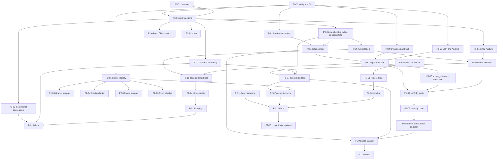

# NUmer 2.0 plan

Seven phases, 83 tasks. One task is one pull request that a mid-tier model finishes in one
session. Every task has an execution prompt in `prompts/`; phases 0 to 3 are complete
prompts (except P3-12 and P3-13), later phases are outlines to be expanded when their phase
starts.

Read with: `DECISIONS.md` (why), `DESIGN.md` (how UI looks), `USER_ACTIONS.md` (what only the
owner can do), `RESEARCH.md` (evidence).

## How to read a task

- **Repo:** NUmer unless stated.
- **Risk:** low, med or high. High means production data, security rules or money.
- **Executor:** recommended model and effort.
- **Parallel:** tasks listed together under "can run together" touch disjoint files.
- **Owner:** what the owner must do. "Approval" means the task changes something on the
  shared server or in a store listing and must not be applied without a yes.
- No executor deploys, pushes, or connects to a server. Deploys are owner actions.

## Phases and releases

| Phase | Outcome | Release it ends in |
|---|---|---|
| 0 Foundation | AI analysis paused behind a coming-soon screen; the critical security holes are closed; the trigger cost is fixed; verify script, CI, flags, staging | 1.1.0. No visible change except fixes |
| 1 Auth rework | sign-up and password reset by 6-digit code in branded email; account deletion complete | 1.2.0 |
| 2 Identity and infrastructure | module backends accept Firebase ID tokens; backups proven by restore tests; one monitor; hardening runbook | no app release; backends redeployed with approval |
| 3 Superapp shell | new tabs, Home with news, Study, Settings behind the avatar, `numer_ui` | 2.0.0. Campus tab hidden until a module is on |
| 4 Modules | Gradus, Clavis, Events, Muto, each behind its flag | 2.1.0 to 2.4.0, one module per release |
| 5 Cross-module polish | notifications, deletion drill, search, privacy of peer stats | 2.5.0 |
| 6 Developer docs | docs describe the superapp | no app release |

Each phase leaves `main` releasable for current users. A doc task closes each phase so the
docs never describe a state that no longer exists.

## Dependency graph (phases 0 to 2)



## What can run together

| Wave | Tasks | Note |
|---|---|---|
| 1 | P0-01, P0-02 | start here; P0-01 is urgent |
| 2 | P0-03, P0-04, P0-09, P0-10, P2-08, P2-09, P2-11 | Flutter, functions and infra files are disjoint |
| 3 | P0-05, P0-07, P0-08, P1-01, P2-01, P2-02 | functions tasks work in separate files after P0-04; they all add a line to `index.ts` and the exports test, so each rebases on merge |
| 4 | P0-06, P0-11, P2-03, P2-04, P2-05, P2-06, P2-10 | four module repos in parallel |
| 5 | P0-12, then P1-03 | P0-12 alone: it moves code that many tasks touch |
| 6 | P0-13, then P0-14, then P0-15 | in sequence: all edit `lib/app/bootstrap.dart` |
| 7 | P1-02, then P1-04, P1-05, P1-06 in sequence; P1-07 and P1-09 beside them | the three client tasks share `auth_service.dart` |
| 8 | P1-08 | only after the owner confirms adoption |
| 9 | P0-16, P1-10, P2-07, P2-12, P2-13 | |

Phase 2 does not wait for phase 1 except P2-07.

---

## Phase 0: Foundation

### P0-01 Pause AI analysis behind a coming-soon screen
- **Goal:** the AI analysis screen says the feature is coming soon, and the broken
  `analyzeCourseAi` callable and all Gemini code are removed. The feature returns in P5-07.
- **Depends on:** none. **Touches:** `functions/src/index.ts`, `functions/package.json`,
  `lib/features/ai_analysis/`, `lib/core/data/storage.dart` (analysis cache), ARB files.
- **Risk:** low. **Executor:** sonnet, medium.
- **Acceptance:** no Gemini code or `analyzeCourseAi` in `functions/`; the service and mock
  analysis are gone from `lib/`; the screen shows one localized sentence; `npm run build`,
  `flutter analyze` and `flutter test` pass.
- **Owner:** delete the deployed callable.

### P0-02 Verify script, CI and conventions
- **Goal:** one command proves a change is acceptable, and `AGENTS.md` states the code
  conventions every later prompt relies on.
- **Depends on:** none. **Touches:** `scripts/`, `test/boundaries/`, `.github/workflows/`,
  `AGENTS.md`, ARB files (missing keys), one format-only commit over `lib/` and `test/`.
- **Risk:** low. **Executor:** sonnet, high.
- **Acceptance:** `./scripts/verify.sh` passes on a clean checkout; the boundary test fails
  when a new violation is added; ARB key sets are equal in EN, RU and KK; the coverage
  baseline is recorded.
- **Owner:** review the translations added for the missing RU and KK keys.

### P0-03 SDK constraint, Android toolchain, unused packages
- **Goal:** the pubspec says what the lock already requires, Android builds on the toolchain
  the plugins ask for, and unused packages are gone.
- **Depends on:** P0-02. **Touches:** `pubspec.yaml`, `pubspec.lock`, `android/`.
- **Risk:** med. **Executor:** sonnet, medium.
- **Acceptance:** `sdk: ^3.10.0`; AGP 8.12.1 or newer 8.x, Gradle 8.13 or newer, Kotlin
  2.2.0; `image_picker`, `animations`, `vector_math` removed; `./scripts/verify.sh` passes;
  `flutter build apk --debug` succeeds.
- **Owner:** install the build on one Android and one iOS device and run the smoke list.

### P0-04 Split the functions source and add a test harness
- **Goal:** each area of Cloud Functions lives in its own file so later tasks do not collide,
  and functions and rules can be tested against the emulator.
- **Depends on:** P0-01, P0-02. **Touches:** `functions/src/**`, `functions/package.json`,
  `firebase.json`, `functions/test/`, `scripts/verify.sh`.
- **Risk:** med. **Executor:** sonnet, high.
- **Acceptance:** the set of exported function names is unchanged; `npm test` and
  `npm run test:emulator` pass; no file under `functions/src/` exceeds 400 lines.
- **Owner:** none.

### P0-05 Membership index and public profiles
- **Goal:** two server-written collections that rules and clients can trust:
  `groupIndex/{uid}` and `publicProfiles/{uid}`.
- **Depends on:** P0-04. **Touches:** `functions/src/groups/`, `functions/src/profiles/`,
  `functions/scripts/`.
- **Risk:** med. **Executor:** sonnet, high.
- **Acceptance:** emulator tests: joining and leaving updates the index; a profile change
  updates the mirror and an unrelated change writes nothing; the mirror never contains
  `email` or `deviceId`; both backfill scripts have a dry-run mode.
- **Owner:** deploy the two triggers; run both backfills; confirm counts.

### P0-06 Firestore rules stage 1
- **Goal:** close every critical and high finding that can be closed without breaking an
  installed app version.
- **Depends on:** P0-05 deployed and backfilled. **Touches:** `firestore/firestore.rules`,
  `functions/test/rules/`.
- **Risk:** high. **Executor:** opus, high.
- **Acceptance:** rules tests cover each exploit (denied) and each legitimate flow with the
  exact payloads installed versions send (allowed); `npm run test:emulator` passes.
- **Owner:** deploy the rules; watch for permission errors for a day; know the rollback
  command.

### P0-07 Callable hardening
- **Goal:** validated ids, a server-side nudge cooldown, join attempt limits, no dead
  functions, no internal error text.
- **Depends on:** P0-04. **Touches:** `functions/src/groups/`, `functions/src/nudges/`,
  `functions/src/shared/`.
- **Risk:** med. **Executor:** sonnet, high.
- **Acceptance:** emulator tests: a slash in an id returns `invalid-argument`; a second nudge
  to the same person within an hour returns `resource-exhausted`; a sixth wrong join code in
  an hour returns `resource-exhausted`; `getMemberSubjectStats` and `deleteGroup` are gone.
- **Owner:** deploy; delete the two removed functions from the project.

### P0-08 Incremental study aggregates
- **Goal:** a session write costs about 3 reads instead of about 111, with identical public
  output.
- **Depends on:** P0-04. **Touches:** `functions/src/aggregates/`.
- **Risk:** high. **Executor:** opus, high.
- **Acceptance:** for a generated history, the incremental payload equals the legacy payload
  after every event; duplicate and out-of-order events change nothing; a notes-only edit
  writes nothing; reads per event are logged and at most 5 after the first event.
- **Owner:** deploy with the flag off, turn on shadow mode, check the logs for mismatches for
  3 days, then turn the flag on.

### P0-09 Sync: push on change, pull on resume
- **Goal:** a local change pushes and no longer pulls; pulls happen on resume, on manual
  refresh, and at most every 10 minutes.
- **Depends on:** P0-02. **Touches:** `lib/core/data/sync_service.dart`,
  `lib/app/app_state.dart` (`_triggerSync` only).
- **Risk:** med. **Executor:** sonnet, high.
- **Acceptance:** a unit test of the pull schedule (none yet, 9 minutes, 10 minutes,
  forced); `_triggerSync` calls the new push-only method; manual sync still always pulls.
- **Owner:** two-device check: a change on one device appears on the other after a manual
  sync, or after a resume more than 10 minutes after its last pull.

### P0-10 Remove redundant writes
- **Goal:** cold start and app load stop writing documents that did not change.
- **Depends on:** P0-02. **Touches:** `lib/features/auth/data/auth_service.dart` (token and
  email index writes), `lib/app/app_state.dart` (the active-session write).
- **Risk:** med. **Executor:** sonnet, medium.
- **Acceptance:** tests: the same FCM token within 7 days is not written again; the same
  email is not re-indexed; an unchanged active-session state is not re-sent.
- **Owner:** none.

### P0-11 Groups: public profiles and listener hygiene on the client
- **Goal:** the groups feature reads peers from `publicProfiles`, stops writing on read, and
  stops creating listeners inside `build`.
- **Depends on:** P0-05, P0-10. **Touches:** `lib/features/groups/`,
  `lib/shared/widgets/universal_avatar.dart`, `lib/shared/widgets/user_profile_tile.dart`.
- **Risk:** med. **Executor:** sonnet, high.
- **Acceptance:** no read of `users/{otherUid}` remains in `lib/` (grep); the membership
  stream has no side effect; public groups are limited to 50 and search is debounced; new
  join codes need 8 characters; widget tests for the leaderboard pass with a fake store.
- **Owner:** open a leaderboard on a real group and check names, avatars and presence.

### P0-12 Split `main.dart` into `lib/app/`
- **Goal:** `main.dart` is an entry point; bootstrap, root widget, auth gate and shell are
  separate files; a navigator key exists.
- **Depends on:** P0-03, P0-09, P0-11. **Touches:** `lib/main.dart`, `lib/app/`.
- **Risk:** med. **Executor:** sonnet, high.
- **Acceptance:** `lib/main.dart` is at most 40 lines; no file in `lib/app/` except
  `app_state.dart` exceeds 600 lines; no behaviour change; the boundary allow-list shrinks.
- **Owner:** run the smoke list on a device.

### P0-13 Remote flags and the minimum-build gate
- **Goal:** modules can be switched on per user without a release, and a future version can
  be made mandatory.
- **Depends on:** P0-12, P0-06. **Touches:** `lib/core/config/`, `lib/app/`, ARB files.
- **Risk:** low. **Executor:** sonnet, medium.
- **Acceptance:** tests: missing document means every module off; `allow` and `rollout`
  work; a higher `minSupportedBuild` shows the update screen; startup makes no awaited
  network call.
- **Owner:** create `config/app` in the console.

### P0-14 Observability
- **Goal:** crashes are visible, and startup time and app size have recorded baselines.
- **Depends on:** P0-13. **Touches:** `pubspec.yaml`, `lib/app/bootstrap.dart`, `scripts/`,
  `docs/PERFORMANCE.md`.
- **Risk:** med. **Executor:** sonnet, medium.
- **Acceptance:** uncaught Flutter and platform errors reach the crash reporter in release
  builds only; `scripts/measure_startup.sh` and `scripts/measure_size.sh` exist and print
  one number each; `docs/PERFORMANCE.md` has the budget table with empty baseline cells.
- **Owner:** decide O-7; run both scripts on the reference device and fill the baselines;
  add a billing budget alert.

### P0-15 Staging project and emulator workflow
- **Goal:** functions and rules can be deployed to a staging project, and the app can run
  against staging or the emulator, without touching production.
- **Depends on:** P0-14. **Touches:** `.firebaserc`, `lib/core/firebase_options.dart`,
  `scripts/`, `docs/INFRASTRUCTURE.md`.
- **Risk:** med. **Executor:** sonnet, high.
- **Acceptance:** `scripts/deploy_staging.sh` refuses any project other than staging; a debug
  build with `APP_ENV=staging` talks to the staging project; production builds are
  unchanged.
- **Owner:** create the staging Firebase project and register the apps.

### P0-16 Docs after foundation
- **Goal:** `AGENTS.md` and `docs/INFRASTRUCTURE.md` are true again.
- **Depends on:** P0-07, P0-08, P0-15. **Touches:** `AGENTS.md`, `README.md`,
  `docs/INFRASTRUCTURE.md`.
- **Risk:** low. **Executor:** sonnet, low.
- **Acceptance:** every stale claim listed in `RESEARCH.md` 11.1 is fixed or removed; each
  subject in 11.2 has one owner.
- **Owner:** none.

---

## Phase 1: Auth rework

### P1-01 Transactional email module
- **Goal:** Cloud Functions can send a localized, branded email through one interface.
- **Depends on:** P0-04. **Touches:** `functions/src/mail/`, `functions/scripts/`.
- **Risk:** med. **Executor:** sonnet, medium.
- **Acceptance:** templates for verification code, reset code and password-changed notice in
  EN, RU and KK, each with HTML and plain text; the subject never contains the code; unit
  tests with a fake sender; a script sends a test email on staging.
- **Owner:** choose the provider and domain (O-2); add DNS records; send test emails to an
  `@nu.edu.kz` inbox and a Gmail inbox.

### P1-02 Email-code callables
- **Goal:** the five callables of D-18 with their storage, limits and tests.
- **Depends on:** P1-01, P0-06. **Touches:** `functions/src/auth/`.
- **Risk:** high. **Executor:** opus, high.
- **Acceptance:** emulator tests for every row of the limits table and every error reason; a
  code is never stored or logged in plain text; 6 concurrent wrong guesses leave attempts at
  5; reset responses for existing and unknown addresses are identical.
- **Owner:** create the HMAC secret; enable TTL policies; deploy to staging first.

### P1-03 `numer_ui`: tokens and the code field
- **Goal:** the design tokens exist as a package, with the six-box code field.
- **Depends on:** P0-02, P0-12. **Touches:** `packages/numer_ui/`, `pubspec.yaml`,
  `lib/app/app_theme.dart`.
- **Risk:** low. **Executor:** sonnet, high.
- **Acceptance:** `NumerSpace`, `NumerRadius`, `NumerMotion`, `NumerColors`, `NumerText`,
  `NumerOtpField` and `NumerButtonChild` match `DESIGN.md`; the contrast test passes for five seeds in both modes;
  the field accepts a pasted code and exposes the autofill hint.
- **Owner:** none.

### P1-04 Email verification by code (client)
- **Goal:** a new user types the code from the email instead of leaving the app to tap a
  link.
- **Depends on:** P1-02, P1-03, P0-12. **Touches:** `lib/features/auth/`,
  `lib/app/auth_gate.dart`, ARB files.
- **Risk:** med. **Executor:** sonnet, high.
- **Acceptance:** widget tests for every state in `RESEARCH.md` 4.4; the dialog and its
  polling are deleted; screenshots per `DESIGN.md` section 12.
- **Owner:** sign up on staging with a real inbox.

### P1-05 Password reset by code (client)
- **Goal:** forgot password is email, code, new password, inside the app.
- **Depends on:** P1-04. **Touches:** `lib/features/auth/`, ARB files.
- **Risk:** med. **Executor:** sonnet, high.
- **Acceptance:** widget tests for the three steps and the expired-ticket path;
  `sendPasswordResetSecure` is deleted; screenshots.
- **Owner:** reset a password on staging.

### P1-06 Retire `email_index` on the client
- **Goal:** the client no longer reads or writes `email_index` or the profile's
  `emailVerified`, and auth has no hard-coded English.
- **Depends on:** P1-05. **Touches:** `lib/features/auth/`, ARB files.
- **Risk:** low. **Executor:** sonnet, medium.
- **Acceptance:** `grep -rn "email_index" lib/` is empty; no string literal shown to the user
  remains in `lib/features/auth/`.
- **Owner:** none.

### P1-07 Account deletion rework
- **Goal:** deleting an account removes everything, nothing re-creates it, and an account
  event is queued for the modules.
- **Depends on:** P0-05, P0-07, P1-02. **Touches:** `functions/src/account/`,
  `functions/src/aggregates/`, `functions/src/groups/`, `lib/features/auth/`,
  `lib/features/account/`.
- **Risk:** high. **Executor:** opus, high.
- **Acceptance:** the emulator test from `RESEARCH.md` 3.4 passes: after deletion and after
  all triggers settle, no document about the user exists anywhere; the purge can be run
  twice and restarted; a daily sweep removes late writes from other devices; the client
  fallback is gone; the client asks for the password before deleting.
- **Owner:** delete a test account on staging and inspect the database.

### P1-08 Firestore rules stage 2
- **Goal:** the remaining exposure is closed once enough users have updated.
- **Depends on:** P0-11, P1-06, P1-07, P1-09, and the owner's adoption check. **Touches:**
  `firestore/firestore.rules`, `functions/test/rules/`, `functions/scripts/`.
- **Risk:** high. **Executor:** opus, medium.
- **Acceptance:** rules tests: another user's `users/{uid}` is unreadable; an unverified
  token cannot write; `email_index` is closed; legitimate 1.2.0 flows pass.
- **Owner:** confirm at least 90% of weekly active users are on 1.2.0 or later; send the
  update reminder; deploy; run the `email_index` deletion script.

### P1-09 App Check switchable per callable
- **Goal:** App Check can be switched on per callable by configuration.
- **Depends on:** P0-04. **Touches:** `functions/src/shared/`, `functions/.env.example`,
  `docs/INFRASTRUCTURE.md`.
- **Risk:** med. **Executor:** sonnet, medium.
- **Acceptance:** every `requireAppCheck` call passes a callable name; a callable listed in
  `APPCHECK_ENFORCED` rejects a call without a token in the unit test.
- **Owner:** check App Check metrics; enable enforcement callable by callable.

### P1-10 Docs after auth
- **Goal:** docs describe code-based auth, the email service and the deletion order.
- **Depends on:** P1-08, P1-09. **Touches:** `docs/PRODUCT.md`,
  `docs/INFRASTRUCTURE.md`, `AGENTS.md`, `docs/PRIVACY_POLICY.md` (draft for review).
- **Risk:** low. **Executor:** sonnet, low.
- **Owner:** approve the privacy policy wording.

---

## Phase 2: Identity bridge and infrastructure

Server changes in this phase are delivered as code, scripts and a runbook. The owner applies
them. Every task marked **approval** touches the owner's existing server projects.

### P2-01 `numer_identity` library
- **Goal:** one Python package that verifies a Firebase ID token the same way in every
  module backend.
- **Depends on:** P0-02. **Touches:** `backend/numer_identity/`,
  `.github/workflows/identity.yml`.
- **Risk:** high. **Executor:** opus, high.
- **Acceptance:** the 20 test vectors of `RESEARCH.md` 3.5 pass without network; coverage at
  least 95%; `ruff`, `mypy --strict` clean; the package builds a wheel.
- **Owner:** push the tag `identity-v0.1.0` after review.

### P2-02 Module roles as custom claims
- **Goal:** the owner can grant and remove `numer_roles` values.
- **Depends on:** P0-04. **Touches:** `functions/src/roles/`, `functions/scripts/`.
- **Risk:** med. **Executor:** sonnet, medium.
- **Acceptance:** emulator tests: only a caller with `numer:admin` may assign; unknown role
  strings are rejected; removal revokes refresh tokens; the claim stays under 1000 bytes.
- **Owner:** run the bootstrap script once for the owner's own account.

### P2-03 Gradus backend: Firebase adapter
- **Repo:** Gradus. **Depends on:** P2-01. **Risk:** med. **Executor:** sonnet, high.
- **Goal:** `AUTH_ADAPTER=firebase` verifies NUmer's tokens.
- **Acceptance:** the resolver tests in the prompt pass; `./scripts/verify.sh` passes;
  preflight requires the Firebase settings in production.
- **Owner (approval):** redeploy Gradus with the new environment values.

### P2-04 Clavis backend: Firebase adapter
- **Repo:** Clavis. **Depends on:** P2-01. **Risk:** med. **Executor:** sonnet, high.
- **Goal:** as P2-03; bookings are keyed on the Firebase uid.
- **Acceptance:** as P2-03; `issue_token` stays usable only with the `host` adapter.
- **Owner (approval):** answer O-5 for Clavis; redeploy.

### P2-05 Muto backend: Firebase adapter
- **Repo:** Muto. **Depends on:** P2-01. **Risk:** med. **Executor:** sonnet, high.
- **Goal:** as P2-03, and a request without a name or phone in its token no longer wipes the
  stored profile.
- **Acceptance:** the integration tests in the prompt pass, including the no-wipe case.
- **Owner (approval):** redeploy.

### P2-06 EventsBot backend: Firebase bridge
- **Repo:** EventsBot. **Depends on:** P2-01. **Risk:** high. **Executor:** opus, high.
- **Goal:** Flutter routes accept NUmer's tokens; users are keyed by `(issuer, subject)`;
  the role for these sessions comes from the claim on every request.
- **Acceptance:** one additive Alembic revision; integration tests for provisioning,
  verified-email attach, role promote and demote; Telegram paths unchanged.
- **Owner (approval):** answer O-4; back up the database; redeploy.

### P2-07 Account events fan-out
- **Goal:** a deleted or disabled account is delivered to every module with retries.
- **Depends on:** P2-01, P1-07, P0-04. **Touches:** `functions/src/account/`,
  `backend/numer_identity/`.
- **Risk:** med. **Executor:** sonnet, high.
- **Acceptance:** emulator test with a fake module endpoint: delivery, signature, retry after
  a 500, give-up and error log after 72 hours of simulated time; the library verifies a
  signature and rejects a stale timestamp.
- **Owner:** create one secret per module.

### P2-08 Backup restore tests
- **Goal:** a script proves that the newest backup of each module database restores.
- **Depends on:** P2-09. **Touches:** `infra/backup/`.
- **Risk:** low for the script. **Executor:** sonnet, medium.
- **Acceptance:** `shellcheck` clean; a local run against a sample dump passes and writes a
  log line; the script never accepts a production database as its target.
- **Owner (approval):** install it on the server on a weekly timer; run it once by hand.

### P2-09 Muto: fix the restore script and Caddyfile
- **Repo:** Muto. **Depends on:** none. **Risk:** low. **Executor:** sonnet, low.
- **Goal:** `restore.sh` and the dedicated Caddyfile name the service that exists.
- **Acceptance:** no reference to a service named `backend` remains; `shellcheck` clean;
  `docker compose config` valid.
- **Owner:** none.

### P2-10 One monitor and an outside heartbeat
- **Goal:** one small container checks all four module APIs, backup freshness and the restore
  log, reports failures and recoveries, and pings an outside service.
- **Depends on:** P2-08. **Touches:** `infra/monitor/`.
- **Risk:** low. **Executor:** sonnet, medium.
- **Acceptance:** a local run against a fake endpoint alerts after 3 failures, repeats every
  6 hours, and reports recovery; `shellcheck` clean.
- **Owner (approval):** choose the alert channel and heartbeat service; install; remove the
  old Muto monitor.

### P2-11 Host hardening script and runbook
- **Goal:** a read-only audit script, a hardening script that is a dry run by default, and a
  runbook.
- **Depends on:** none. **Touches:** `infra/host/`, `infra/RUNBOOK.md`.
- **Risk:** low for the script, high when applied. **Executor:** sonnet, high.
- **Acceptance:** `harden.sh` changes nothing without `--apply`; each step can be applied
  alone; each step prints how to undo it; `shellcheck` clean.
- **Owner (approval):** run the audit; apply step by step in a quiet hour.

### P2-12 Docs after identity and infrastructure
- **Goal:** `docs/INFRASTRUCTURE.md` describes the backends, identity, roles, account events
  and operations, with no server address in it.
- **Depends on:** P2-07, P2-10, P2-11. **Risk:** low. **Executor:** sonnet, low.

### P2-13 Optional: own project for the reverse proxy, right-sized limits
- **Goal:** a runbook for moving the proxy out of another project and lowering over-sized
  memory limits.
- **Depends on:** P2-12. **Touches:** `infra/RUNBOOK.md`, `infra/edge/`.
- **Risk:** high when applied. **Executor:** opus, medium.
- **Owner (approval):** only if the owner plans to shut down the project that owns the proxy.

---

## Phase 3: Superapp shell

| Id | Title | Depends on | Risk | Executor | Owner |
|---|---|---|---|---|---|
| P3-01 | `numer_ui`: theme builder and components | P1-03 | med | sonnet, high | none |
| P3-02 | `numer_ui`: compatibility layer for module code | P3-01 | med | sonnet, high | none |
| P3-03 | Module registry, session contract, lazy mount | P0-13, P3-01 | med | opus, medium | none |
| P3-04 | Split `home.dart` (no behaviour change) | P0-12 | med | sonnet, high | smoke list |
| P3-05 | New shell: tabs, header avatar, Settings screen, About | P3-03, P3-04, P3-16 | high | sonnet, high | confirm O-1; support address; privacy URL |
| P3-06 | Study root | P3-05 | med | sonnet, high | none |
| P3-07 | Home: today layout | P3-06 | med | sonnet, high | none |
| P3-08 | Feed backend: announcements and composed feed | P2-02, P0-06 | med | sonnet, high | scheduler job; first editor role |
| P3-09 | News on Home and the News screen | P3-07, P3-08 | med | sonnet, high | publish a test announcement |
| P3-10 | Local "Upcoming" store | P3-07 | low | sonnet, medium | none |
| P3-11 | Campus root | P3-05 | low | sonnet, medium | none |
| P3-12 | Design pass: glass, gradients, chips, raw toasts | P3-05, P3-14, P3-15 | med | sonnet, high | review screenshots |
| P3-13 | Docs after shell | P3-12 | low | sonnet, low | none |
| P3-14 | Split `stats.dart` (no behaviour change) | P0-12 | med | sonnet, high | smoke list |
| P3-15 | Split `add_habit_sheet.dart` (no behaviour change) | P0-12 | med | sonnet, high | smoke list |
| P3-16 | Split `habits_screen.dart` (no behaviour change) | P0-12 | med | sonnet, high | smoke list |

Can run together: P3-01, P3-04, P3-08, P3-14, P3-15 and P3-16 (disjoint files); P3-09, P3-10
and P3-11 after P3-07.

The three splits (P3-14 to P3-16) and P3-04 bring the largest files under the size limit
(D-33) before the shell tasks edit them.

Acceptance, common to the UI tasks: the deliverables of `DESIGN.md` section 12, plus:
- P3-03: a test proves that building the shell creates no module object and makes no call.
- P3-05: with every module flag off, the bar has four tabs; Settings opens from the avatar on
  each tab root; `/timer`, `/alarms` and their screens are deleted.
- P3-07: Home performs zero module network calls (counting fake).
- P3-08: one composed document of at most 30 items; rules tests for `feed` and
  `announcements`.
- P3-12: `scripts/design_baseline.txt` shrinks; no pattern count rises.

Releasable at the end: 2.0.0 with the new shell and news, no module visible.

---

## Phase 4: Module integration

Each module ships dark behind its flag, is opened to the `allow` list, then by `rollout`.

| Id | Title | Repo | Depends on | Risk | Executor | Owner |
|---|---|---|---|---|---|---|
| P4-01 | Gradus package: `numer_ui`, token provider, host chrome | Gradus | P3-02 | med | sonnet, high | tag |
| P4-02 | Grades: Hive types 18 to 20, storage, rules | NUmer | P0-06 | high | opus, high | none |
| P4-03 | Grades: sync push and pull | NUmer | P4-02 | high | opus, high | two-device check |
| P4-04 | Mount Gradus: Hive transcript adapter, registry entry, flag | NUmer | P4-01, P4-03, P3-06, P2-03 | med | sonnet, high | flag on for testers |
| P4-05 | Import from standalone Gradus | NUmer | P4-04 | med | sonnet, medium | only if O-5 says data exists |
| P4-06 | Clavis package: `numer_ui`, token provider | Clavis | P3-02 | med | sonnet, high | tag |
| P4-07 | Clavis backend: account events handler | Clavis | P2-07, P2-04 | med | sonnet, medium | approval to redeploy |
| P4-08 | Mount Clavis: registry, Upcoming item, local reminder | NUmer | P4-06, P4-07, P3-10, P3-11 | med | sonnet, high | book and release a slot |
| P4-09 | Events backend: account events, Telegram link | EventsBot | P2-06, P2-07 | high | opus, high | approval to redeploy |
| P4-10 | Events package: `numer_ui`, ARB strings, host chrome, base URL, token provider | EventsBot | P3-02 | high | sonnet, high | tag |
| P4-11 | Mount Events: registry, Telegram link screen, reminders | NUmer | P4-09, P4-10, P3-10, P3-11 | med | sonnet, high | link a Telegram account |
| P4-12 | Muto backend: block user, moderation actions, text filter, account events | Muto | P2-05, P2-07 | high | opus, high | approval to redeploy |
| P4-13 | Muto package: `numer_ui`, host chrome, block and report UI | Muto | P3-02, P4-12 | high | sonnet, high | tag |
| P4-14 | Mount Muto: registry, flag | NUmer | P4-13, P3-11 | med | sonnet, high | storage bucket |
| P4-15 | App Review readiness for user content | NUmer | P4-14 | med | sonnet, medium | review notes, contact details, moderation duty |

Can run together: the four package tasks (P4-01, P4-06, P4-10, P4-13 after P4-12) and the
three backend tasks are in different repos. Mount tasks run in module order.

Gates:
- A module's flag is not opened beyond the `allow` list until its account events handler is
  deployed (Gradus has no server data and needs none).
- Muto is not opened beyond the `allow` list until P4-15 is done.
- Every mount task proves lazy start and the size budget (`DESIGN.md` section 10).

---

## Phase 5: Cross-module polish

| Id | Title | Depends on | Risk | Executor | Owner |
|---|---|---|---|---|---|
| P5-01 | Notifications: tap handling, categories, settings | P3-05 | med | sonnet, high | none |
| P5-02 | Deletion fan-out drill, end to end | P4-07, P4-09, P4-12 | med | sonnet, medium | delete a test account in production |
| P5-03 | Campus search | P4-14 | low | sonnet, medium | none |
| P5-04 | Peer stats from aggregates; sessions and courses owner-only | P0-08, P1-08 | high | opus, high | adoption check before the rules change |
| P5-05 | Optional: avatar glyphs to Material icons | P3-12 | med | sonnet, medium | decide O-6 |
| P5-06 | Budgets enforced in CI | P0-14 | low | sonnet, medium | none |
| P5-07 | Bring back course analysis | P0-04, P1-09, P3-06 | med | sonnet, high | choose the model and provider; set the key |

---

## Phase 6: Developer docs

Doc tasks at the end of phases 0 to 3 keep the docs true. This phase rewrites them for the
finished product.

| Id | Title | Depends on | Executor |
|---|---|---|---|
| P6-01 | `AGENTS.md` for the superapp | phase 4 | sonnet, medium |
| P6-02 | `README.md` | P6-01 | sonnet, low |
| P6-03 | `docs/PRODUCT.md` | phase 4 | sonnet, medium |
| P6-04 | `docs/INFRASTRUCTURE.md` | phase 5 | sonnet, medium |
| P6-05 | Align each module repo's `AGENTS.md` | P6-01 | sonnet, low (four repos) |
| P6-06 | Privacy policy update | phase 4 | sonnet, low; owner approves |

---

## Prompt files

Phases 0 to 2, complete:

```
prompts/P0-01-pause-ai-analysis.md            prompts/P1-01-email-module.md
prompts/P0-02-verify-ci-conventions.md        prompts/P1-02-email-code-callables.md
prompts/P0-03-sdk-android-toolchain.md        prompts/P1-03-numer-ui-tokens.md
prompts/P0-04-split-functions.md              prompts/P1-04-verify-email-by-code.md
prompts/P0-05-membership-index-profiles.md    prompts/P1-05-reset-password-by-code.md
prompts/P0-06-rules-stage-1.md                prompts/P1-06-retire-email-index-client.md
prompts/P0-07-callable-hardening.md           prompts/P1-07-account-deletion.md
prompts/P0-08-incremental-aggregates.md       prompts/P1-08-rules-stage-2.md
prompts/P0-09-sync-push-pull.md               prompts/P1-09-app-check.md
prompts/P0-10-redundant-writes.md             prompts/P1-10-docs-after-auth.md
prompts/P0-11-groups-public-profiles.md       prompts/P2-01-numer-identity.md
prompts/P0-12-split-main.md                   prompts/P2-02-module-roles.md
prompts/P0-13-flags-min-build.md              prompts/P2-03-gradus-firebase-adapter.md
prompts/P0-14-observability.md                prompts/P2-04-clavis-firebase-adapter.md
prompts/P0-15-staging-project.md              prompts/P2-05-muto-firebase-adapter.md
prompts/P0-16-docs-after-foundation.md        prompts/P2-06-events-firebase-bridge.md
                                              prompts/P2-07-account-events.md
                                              prompts/P2-08-restore-tests.md
                                              prompts/P2-09-muto-restore-fix.md
                                              prompts/P2-10-monitor.md
                                              prompts/P2-11-host-hardening.md
                                              prompts/P2-12-docs-after-identity.md
                                              prompts/P2-13-proxy-and-limits.md
```

Phase 3, complete:

```
prompts/P3-01-numer-ui-theme-components.md    prompts/P3-08-feed-backend.md
prompts/P3-02-numer-ui-compat.md              prompts/P3-09-news-client.md
prompts/P3-03-module-registry.md              prompts/P3-10-upcoming-store.md
prompts/P3-04-split-home.md                   prompts/P3-11-campus-root.md
prompts/P3-05-new-shell.md                    prompts/P3-14-split-stats.md
prompts/P3-06-study-root.md                   prompts/P3-15-split-add-habit-sheet.md
prompts/P3-07-home-today.md                   prompts/P3-16-split-habits-screen.md
```

Outlines still to expand: P3-12 and P3-13 in `prompts/P3-outlines.md`, phases 4 to 6 in
`prompts/P4-outlines.md` and `prompts/P5-P6-outlines.md`. Each outline is expanded into a
full prompt with the template in `prompts/TEMPLATE.md` when its phase starts, because the
files it must cite will have moved by then.

## The smoke list

Used by the owner after P0-03, P0-12, P3-04, P3-14, P3-15 and P3-16, on one Android and one iOS device:

1. Cold start reaches Home.
2. Start a timer on a course, stop it, see the session in History.
3. Check a habit; it stays checked after restarting the app.
4. Open the leaderboard of a group; names and avatars show.
5. Change the accent colour; the theme follows.
6. Switch language to RU and KK.
7. Turn on airplane mode, add a session, turn it off, and see it on a second device.
8. Sign out and sign in.
